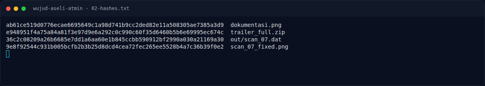
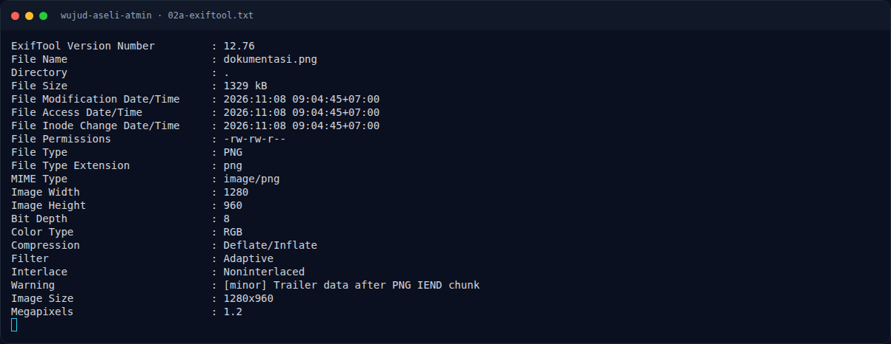
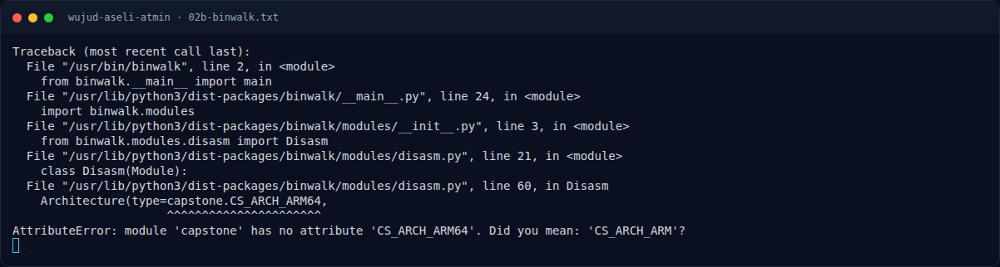
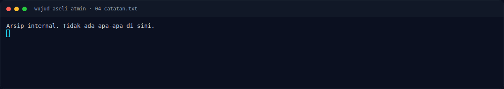
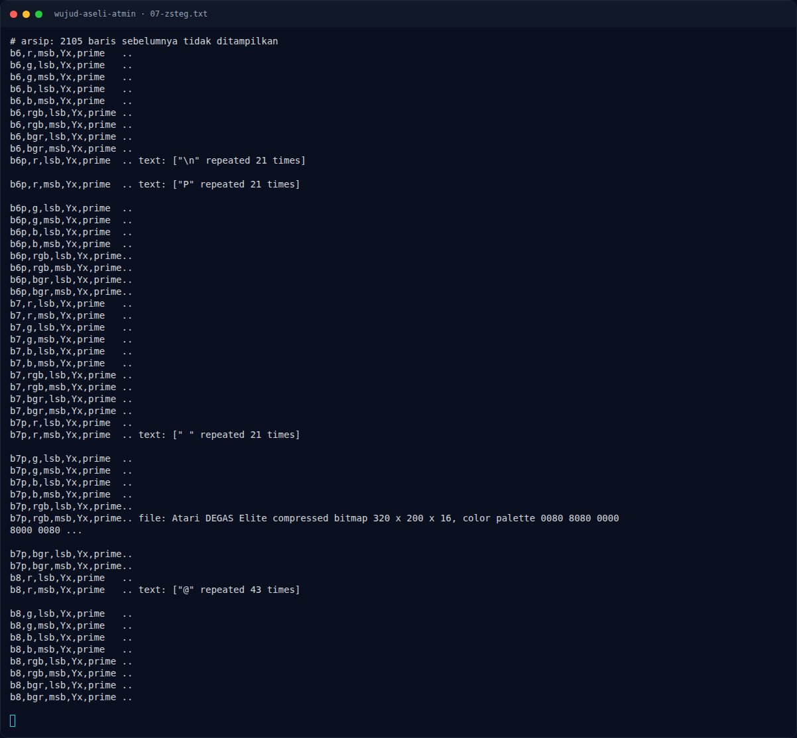
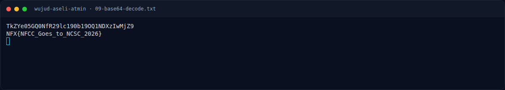
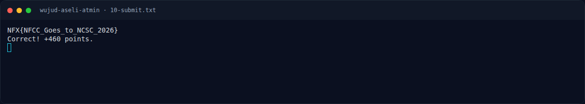

# Wujud Aseli Atmin — Penyelesaian

[← Overview](52-wujud-aseli-atmin.md) · [Index](index.md)

> **Langkah 4/7 — Penyelesaian.** Penyelesaian
>
> **Titik penting:** NFX{NFCC_Goes_to_NCSC_2026}
>
> **Berikutnya:** [Flag](52-wujud-aseli-atmin-05-flag.md)

### 3.1 Script reproduksi

```python
import base64, struct, zlib

# 1. Ambil trailer ZIP dari PNG
d = open('dokumentasi.png','rb').read()
iend = d.find(b'IEND')
start = d.find(b'PK\x03\x04', iend)
tr = d[start:]
open('trailer.zip','wb').write(tr)

# 2. Parse local file headers dan decompress
off = 0
files = {}
while tr[off:off+4] == b'PK\x03\x04':
    (sig, ver, flags, method, mt, md, crc, csize, usize,
     namelen, extralen) = struct.unpack_from('<IHHHHHIIIHH', tr, off)
    name = tr[off+30:off+30+namelen].decode()
    data = tr[off+30+namelen+extralen:off+30+namelen+extralen+csize]
    out = zlib.decompress(data, -15) if method == 8 else data
    files[name] = out
    off += 30 + namelen + extralen + csize

# 3. Perbaiki signature PNG
scan = bytearray(files['scan_07.dat'])
scan[:8] = bytes.fromhex('89504e470d0a1a0a')
open('scan_07_fixed.png','wb').write(scan)

# 4. LSB R channel → base64
from PIL import Image
im = Image.open('scan_07_fixed.png').convert('RGB')
bits = ''.join(str(im.getpixel((x,y))[0] & 1)
               for y in range(im.height) for x in range(im.width))
raw = bytes(int(bits[i:i+8], 2) for i in range(0, len(bits)//8*8, 8))
print(raw[:80])
# b'TkZYe05GQ0NfR29lc190b19OQ1NDXzIwMjZ9...'
```

Output base64:

```text
TkZYe05GQ0NfR29lc190b19OQ1NDXzIwMjZ9
```

Decode:

```bash
echo 'TkZYe05GQ0NfR29lc190b19OQ1NDXzIwMjZ9' | base64 -d
```

```text
NFX{NFCC_Goes_to_NCSC_2026}
```

### Evidence langkah ini



*Terminal evidence — `02-hashes.txt` (arsip transkrip sesi solve).*



*Terminal evidence — `02a-exiftool.txt` (arsip transkrip sesi solve).*



*Terminal evidence — `02b-binwalk.txt` (arsip transkrip sesi solve).*



*Terminal evidence — `04-catatan.txt` (arsip transkrip sesi solve).*



*Terminal evidence — `07-zsteg.txt` (arsip transkrip sesi solve).*



*Terminal evidence — `09-base64-decode.txt` (arsip transkrip sesi solve).*



*Terminal evidence — `10-submit.txt` (arsip transkrip sesi solve).*

**Berkas mentah langkah ini:**

- [`02-hashes.txt`](assets/wujud-aseli-atmin/02-hashes.txt)
- [`02a-exiftool.txt`](assets/wujud-aseli-atmin/02a-exiftool.txt)
- [`02b-binwalk.txt`](assets/wujud-aseli-atmin/02b-binwalk.txt)
- [`04-catatan.txt`](assets/wujud-aseli-atmin/04-catatan.txt)
- [`07-zsteg.txt`](assets/wujud-aseli-atmin/07-zsteg.txt)
- [`09-base64-decode.txt`](assets/wujud-aseli-atmin/09-base64-decode.txt)
