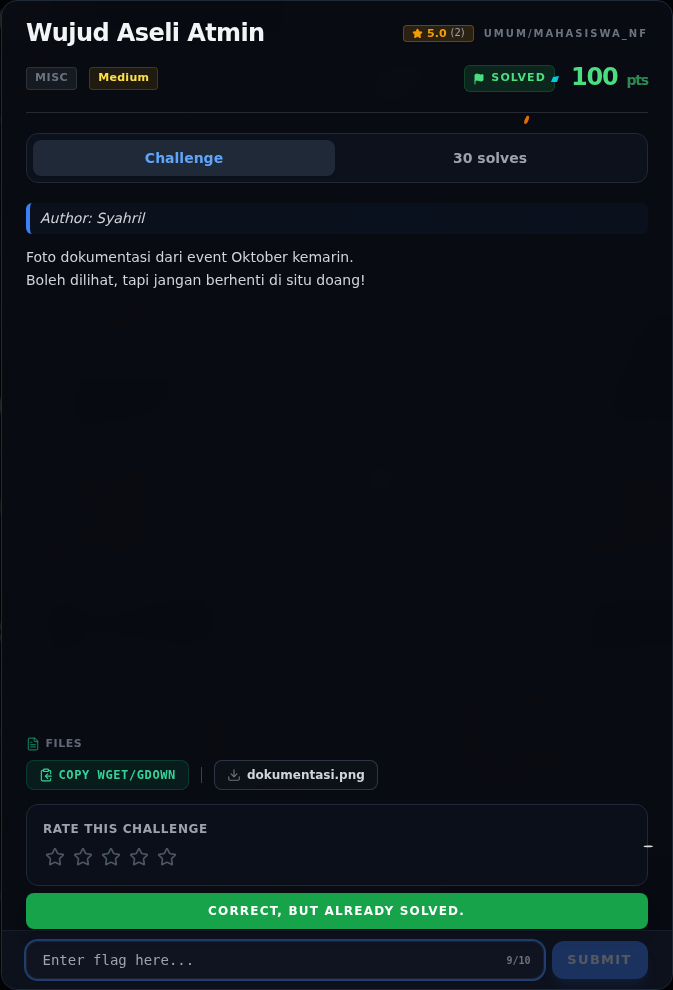
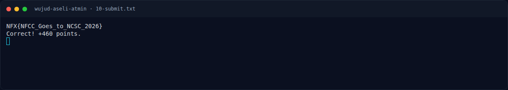

# Wujud Aseli Atmin — Flag & Verifikasi

[← Overview](52-wujud-aseli-atmin.md) · [Index](index.md)

> **Flag:** `NFX{NFCC_Goes_to_NCSC_2026}`
> **Status:** `VERIFIED`

```text
NFX{NFCC_Goes_to_NCSC_2026}
```

Verifikasi platform:

```text
HTTP 200
{"success": true, "message": "Correct! +460 points."}
```

### Bukti submit di platform



*Submit flag di platform: `CORRECT, BUT ALREADY SOLVED.`*

### Evidence langkah ini



*Terminal evidence — `10-submit.txt` (arsip transkrip sesi solve).*

**Berkas mentah langkah ini:**

- [`10-submit.txt`](assets/wujud-aseli-atmin/10-submit.txt)

> **Verifikasi platform:** flag sudah diterima. Recheck 2026-11-09 mengembalikan `Correct, but already solved.`
