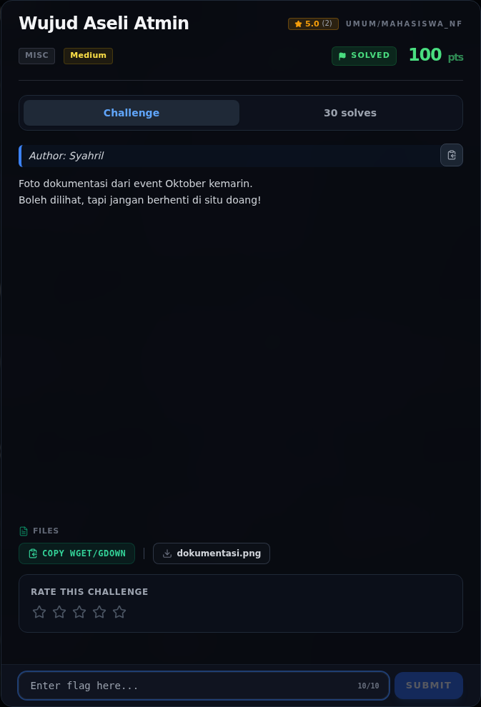
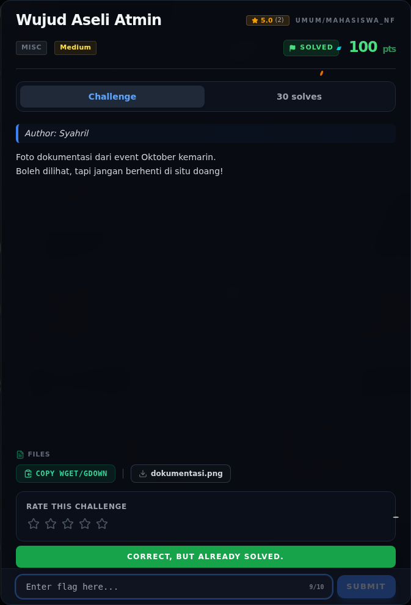
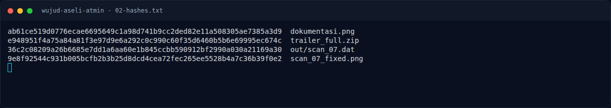
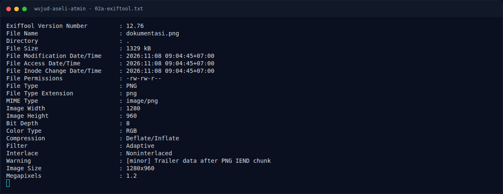
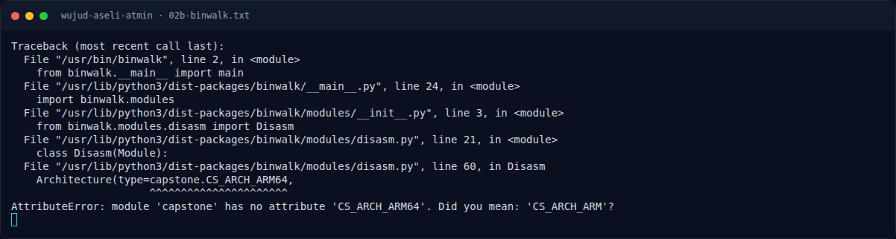
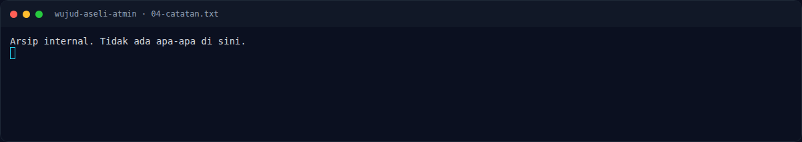
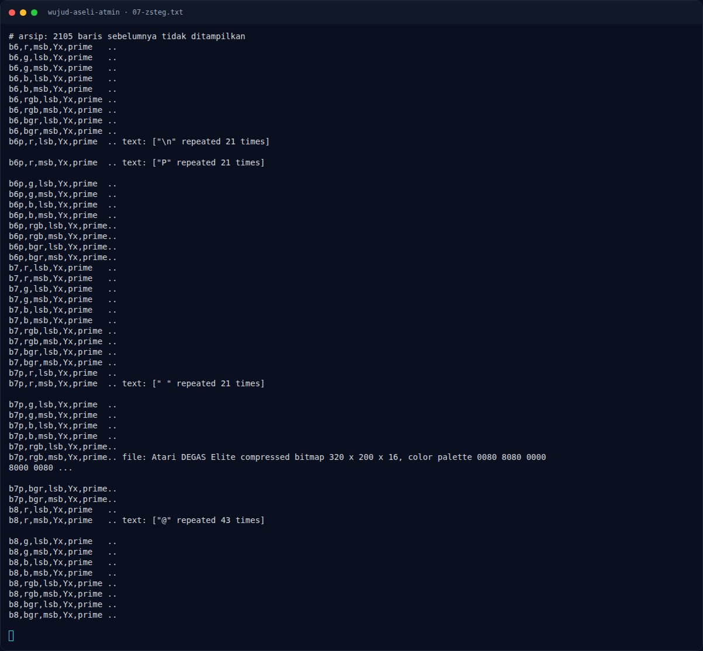
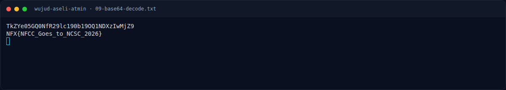
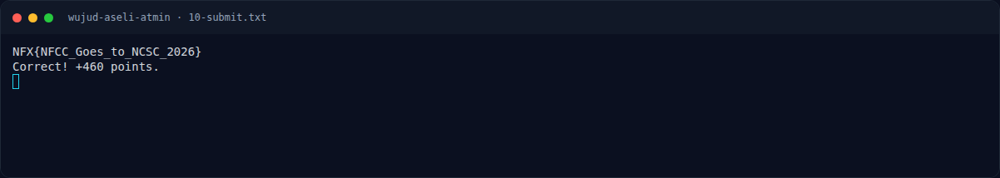

# Wujud Aseli Atmin — Evidence / Bukti

11 screenshot10 transkrip / script

[← Overview](52-wujud-aseli-atmin.md) · [Index](index.md)

> **Langkah 6/7 — Bukti / Evidence.** Semua di writeups/assets/wujud-aseli-atmin/:
>
> **Titik penting:** arsip screenshot dan transkrip
>
> **Berikutnya:** [Referensi](52-wujud-aseli-atmin-07-referensi.md)

## Arsip Evidence

> Semua file berasal dari `assets/wujud-aseli-atmin/`. Screenshot platform dan terminal adalah bukti asli dari sesi solve; transkrip mentah tetap ditautkan di bagian bawah.

### Platform

<figure><figcaption>00-challenge-platform.png</figcaption></figure>

*Challenge brief asli di platform NFX CTF 2026.*

<figure><figcaption>00b-submit-platform.png</figcaption></figure>

*Submit flag di platform: `CORRECT, BUT ALREADY SOLVED.`*

### Terminal (arsip sesi)

<figure><figcaption>term-02-hashes.png</figcaption></figure>

*Terminal evidence — `02-hashes.txt` (arsip transkrip sesi solve).*

<figure><figcaption>term-02a-exiftool.png</figcaption></figure>

*Terminal evidence — `02a-exiftool.txt` (arsip transkrip sesi solve).*

<figure><figcaption>term-02b-binwalk.png</figcaption></figure>

*Terminal evidence — `02b-binwalk.txt` (arsip transkrip sesi solve).*

<figure><figcaption>term-04-catatan.png</figcaption></figure>

*Terminal evidence — `04-catatan.txt` (arsip transkrip sesi solve).*

<figure><figcaption>term-07-zsteg.png</figcaption></figure>

*Terminal evidence — `07-zsteg.txt` (arsip transkrip sesi solve).*

<figure><figcaption>term-09-base64-decode.png</figcaption></figure>

*Terminal evidence — `09-base64-decode.txt` (arsip transkrip sesi solve).*

<figure><figcaption>term-10-submit.png</figcaption></figure>

*Terminal evidence — `10-submit.txt` (arsip transkrip sesi solve).*

### Screenshot langkah

<figure><figcaption>01-dokumentasi.png</figcaption></figure>

*Evidence — `01-dokumentasi.png`.*

<figure><figcaption>06-scan_07_fixed.png</figcaption></figure>

*Evidence — `06-scan_07_fixed.png`.*

### Transkrip mentah & script

- [`02-hashes.txt`](assets/wujud-aseli-atmin/02-hashes.txt)
- [`02a-exiftool.txt`](assets/wujud-aseli-atmin/02a-exiftool.txt)
- [`02b-binwalk.txt`](assets/wujud-aseli-atmin/02b-binwalk.txt)
- [`03-trailer.zip`](assets/wujud-aseli-atmin/03-trailer.zip)
- [`04-catatan.txt`](assets/wujud-aseli-atmin/04-catatan.txt)
- [`05-scan_07.dat`](assets/wujud-aseli-atmin/05-scan_07.dat)
- [`07-zsteg.txt`](assets/wujud-aseli-atmin/07-zsteg.txt)
- [`08-lsb-b1-r.bin`](assets/wujud-aseli-atmin/08-lsb-b1-r.bin)
- [`09-base64-decode.txt`](assets/wujud-aseli-atmin/09-base64-decode.txt)
- [`10-submit.txt`](assets/wujud-aseli-atmin/10-submit.txt)

## Tabel Evidence

Semua di `writeups/assets/wujud-aseli-atmin/`:

| Bukti | File | Keterangan |
|---|---|---|
| Foto asli | `01-dokumentasi.png` | PNG 1280×960 |
| Hash | `02-hashes.txt` | sha256 semua artefak |
| Exiftool | `02a-exiftool.txt` | warning trailer IEND |
| Binwalk | `02b-binwalk.txt` | ZIP trailer |
| Trailer ZIP | `03-trailer.zip` | 4.100 byte |
| Catatan decoy | `04-catatan.txt` | “Tidak ada apa-apa” |
| Scan rusak | `05-scan_07.dat` | 8 byte signature nol |
| Scan diperbaiki | `06-scan_07_fixed.png` | PNG 400×300 |
| zsteg | `07-zsteg.txt` | temuan base64 di `b1,r,lsb,xy` |
| LSB biner | `08-lsb-b1-r.bin` | ekstraksi kanal R |
| Decode | `09-base64-decode.txt` | base64 → flag |
| Submit | `10-submit.txt` | `Correct! +460 points.` |