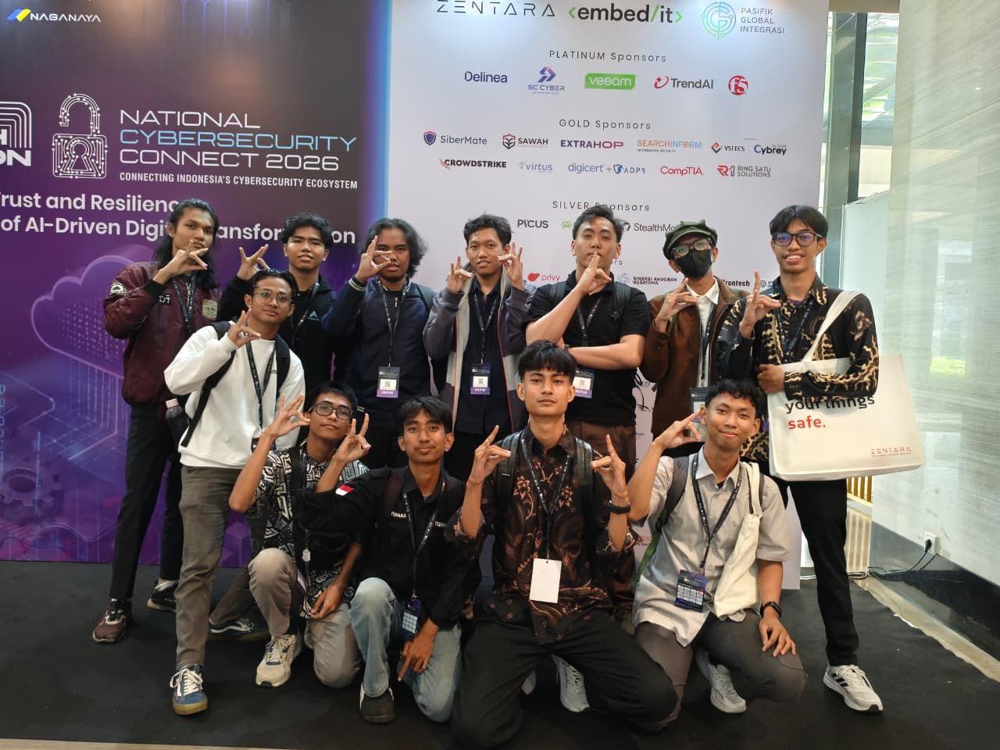
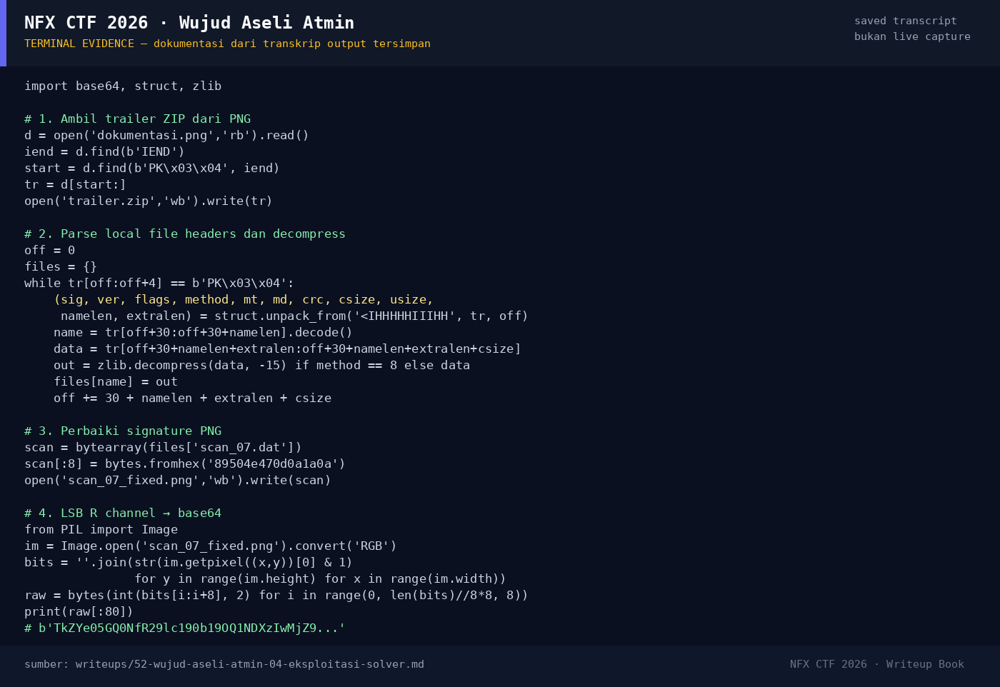

# Wujud Aseli Atmin — Evidence / Bukti

3 screenshot10 transkrip / script

[← Overview](52-wujud-aseli-atmin.md) · [Index](index.md)

## Arsip Evidence

> Semua file di bawah berasal dari folder `assets/wujud-aseli-atmin/`. Screenshot ditempel langsung; file teks/script ditautkan.

### Screenshot

<figure><figcaption>01-dokumentasi.png</figcaption></figure>
<figure><figcaption>06-scan_07_fixed.png</figcaption></figure>
<figure><figcaption>98-terminal-evidence.png</figcaption></figure>

### Transkrip / file pendukung

- [`02-hashes.txt`](assets/wujud-aseli-atmin/02-hashes.txt)
- [`02a-exiftool.txt`](assets/wujud-aseli-atmin/02a-exiftool.txt)
- [`02b-binwalk.txt`](assets/wujud-aseli-atmin/02b-binwalk.txt)
- [`03-trailer.zip`](assets/wujud-aseli-atmin/03-trailer.zip)
- [`04-catatan.txt`](assets/wujud-aseli-atmin/04-catatan.txt)
- [`05-scan_07.dat`](assets/wujud-aseli-atmin/05-scan_07.dat)
- [`07-zsteg.txt`](assets/wujud-aseli-atmin/07-zsteg.txt)
- [`08-lsb-b1-r.bin`](assets/wujud-aseli-atmin/08-lsb-b1-r.bin)
- [`09-base64-decode.txt`](assets/wujud-aseli-atmin/09-base64-decode.txt)
- [`10-submit.txt`](assets/wujud-aseli-atmin/10-submit.txt)

## Tabel Evidence

Semua di `writeups/assets/wujud-aseli-atmin/`:

| Bukti | File | Keterangan |
|---|---|---|
| Foto asli | `01-dokumentasi.png` | PNG 1280×960 |
| Hash | `02-hashes.txt` | sha256 semua artefak |
| Exiftool | `02a-exiftool.txt` | warning trailer IEND |
| Binwalk | `02b-binwalk.txt` | ZIP trailer |
| Trailer ZIP | `03-trailer.zip` | 4.100 byte |
| Catatan decoy | `04-catatan.txt` | “Tidak ada apa-apa” |
| Scan rusak | `05-scan_07.dat` | 8 byte signature nol |
| Scan diperbaiki | `06-scan_07_fixed.png` | PNG 400×300 |
| zsteg | `07-zsteg.txt` | temuan base64 di `b1,r,lsb,xy` |
| LSB biner | `08-lsb-b1-r.bin` | ekstraksi kanal R |
| Decode | `09-base64-decode.txt` | base64 → flag |
| Submit | `10-submit.txt` | `Correct! +460 points.` |