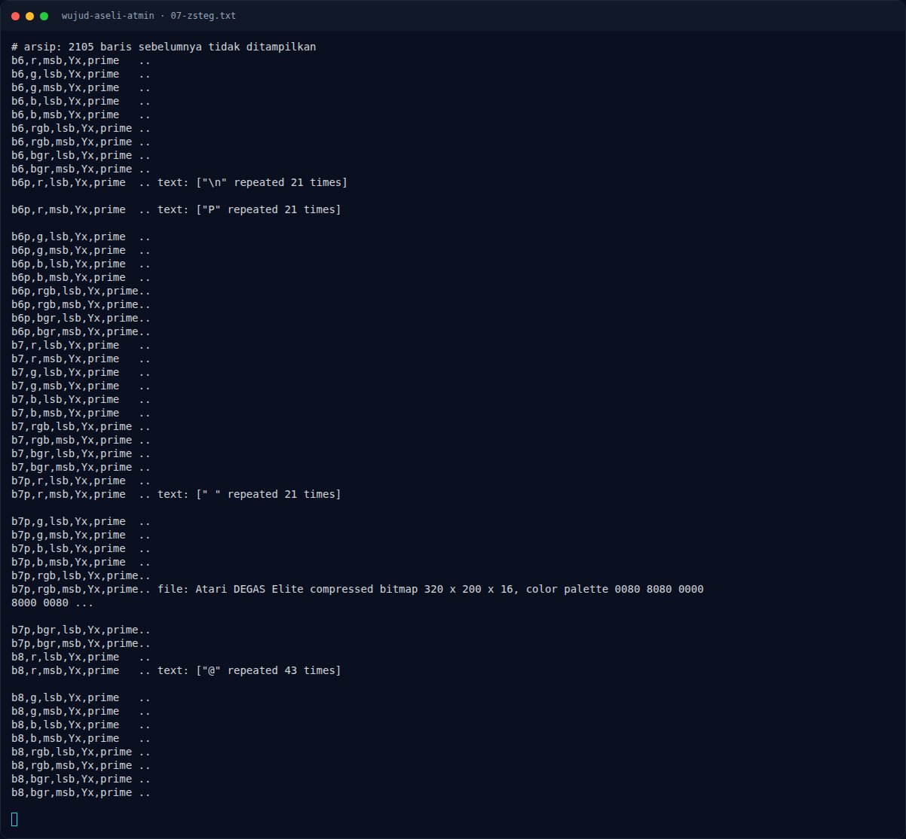

# Wujud Aseli Atmin — Referensi

[← Overview](52-wujud-aseli-atmin.md) · [Index](index.md)

> **Langkah 6/6 — Referensi.** Referensi
>
> **Titik penting:** —
>
> **Selesai.** Kembali ke [Overview](52-wujud-aseli-atmin.md).

- PNG specification: signature, IHDR, IEND.
- ZIP local file header format.
- `zsteg` LSB extraction.
- Teknik trailer data setelah `IEND`.

### Evidence langkah ini

*Terminal evidence — `07-zsteg.txt` (arsip transkrip sesi solve).*

**Berkas mentah langkah ini:**

- [`07-zsteg.txt`](assets/wujud-aseli-atmin/07-zsteg.txt)
