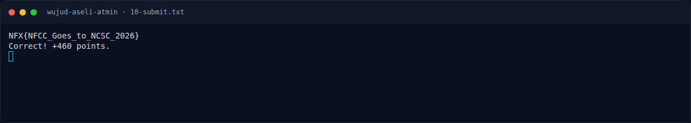

# Wujud Aseli Atmin

Track Mahasiswa NF · MiscMedium420 poinVERIFIED

| Field | Nilai |
|---|---|
| Event | `umum/mahasiswa_nf` |
| Kategori | `Misc` |
| Difficulty | `Medium` |
| Poin (snapshot) | `420` |
| Author | `Syahril` |
| Solves | `2 saat writeup dibuat` |
| Tools | binwalk, exiftool, zsteg, sage, z3, git |
| Flag | `NFX{NFCC_Goes_to_NCSC_2026}` |
| Status | `VERIFIED` |
| Metode | **FULL** — metode utama berhasil direproduksi. |
| Snapshot | 2026-11-13 |

[← Kembali ke Index](index.md)

## TL;DR

- **Flag:** `NFX{NFCC_Goes_to_NCSC_2026}`
- **Metode:** **FULL** — metode utama berhasil direproduksi.
- **Baca langkah lengkap:** [Cara Mendapatkan Flag](52-wujud-aseli-atmin-04-flag.md)

## Challenge Brief (platform)

*Challenge brief asli di platform NFX CTF 2026.*

## Alur & Titik Penting

| # | Langkah | Titik penting | Buka |
|---:|---|---|---|
| 1 | Recon | file dokumentasi.png | [Buka](52-wujud-aseli-atmin-01-recon.md) |
| 2 | Analisis | file scan_07.dat | [Buka](52-wujud-aseli-atmin-02-analisis.md) |
| 3 | Penyelesaian | tr = d[start:] | [Buka](52-wujud-aseli-atmin-03-penyelesaian.md) |
| 4 | Flag | NFX{NFCC_Goes_to_NCSC_2026} | [Buka](52-wujud-aseli-atmin-04-flag.md) |
| 5 | Bukti / Evidence | arsip screenshot dan transkrip | [Buka](52-wujud-aseli-atmin-05-bukti-evidence.md) |
| 6 | Referensi | — | [Buka](52-wujud-aseli-atmin-06-referensi.md) |

## Ringkasan

> Challenge baru di event umum (bukan extend), dibuat 2026-11-07 23:51.
> Attachment: `dokumentasi.png`.
## Cerita Singkat

Jadi ceritanya gini. Kita dikasih satu foto dokumentasi event **National
Cybersecurity Connect 2026**. Sekilas biasa aja — foto orang-orang, banner,
selesai. Tapi deskripsinya bilang “jangan berhenti di situ doang”, jadi kita
cek lebih dalam.

Pertama, foto ini dibuka pakai `exiftool`. Eh, muncul warning: ada **data
tambahan setelah akhir file PNG** (trailer). Dari situ kita curiga. Ternyata
trailer-nya adalah **ZIP** berisi dua file: `catatan.txt` yang isinya cuma
godaan (“Tidak ada apa-apa di sini”), dan `scan_07.dat`.

Nah, `scan_07.dat` ini jahil. Dia sebenarnya **PNG 400×300**, tapi 8 byte
pertama (signature PNG) sengaja dinolkan. Begitu signature-nya kita balikin,
file-nya langsung bisa dibuka. Dari situ kita pakai `zsteg`, dan ketemu
base64 di **LSB kanal merah**. Decode base64-nya, keluar deh flag-nya.

Alur besarnya:

1. Lihat foto → cek metadata.
2. Ketemu trailer ZIP di belakang `IEND`.
3. Ekstrak ZIP → dapat `scan_07.dat`.
4. Perbaiki signature PNG yang dihapus.
5. Ambil LSB kanal R → base64 → decode.
6. Flag: `NFX{NFCC_Goes_to_NCSC_2026}`.
7. Submit → **`Correct! +460 points.`**

Pratinjau evidence. Buka halaman <a href="52-wujud-aseli-atmin-05-bukti-evidence.html">Evidence / Bukti</a> untuk semua screenshot dan transkrip.

## Navigasi Halaman

<a class="nx-page-card" href="52-wujud-aseli-atmin-01-recon.html"><b>Recon</b>Enumerasi target dan bukti awal</a>
<a class="nx-page-card" href="52-wujud-aseli-atmin-02-analisis.html"><b>Analisis</b>Membaca alur dan akar masalah</a>
<a class="nx-page-card" href="52-wujud-aseli-atmin-03-penyelesaian.html"><b>Penyelesaian</b>Baca bagian ini</a>
<a class="nx-page-card" href="52-wujud-aseli-atmin-04-flag.html"><b>Flag</b>Flag dan verifikasi platform</a>
<a class="nx-page-card" href="52-wujud-aseli-atmin-05-bukti-evidence.html"><b>Bukti / Evidence</b>Screenshot, transkrip, dan artefak</a>
<a class="nx-page-card" href="52-wujud-aseli-atmin-06-referensi.html"><b>Referensi</b>Sumber dan bacaan lanjutan</a>

