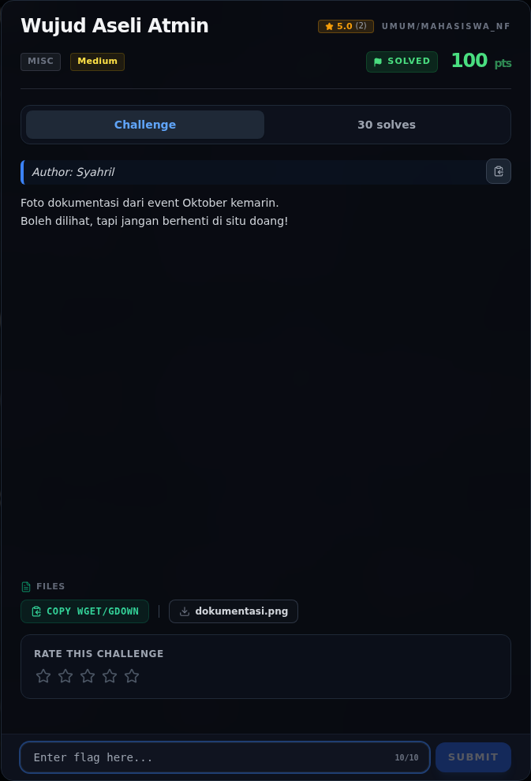
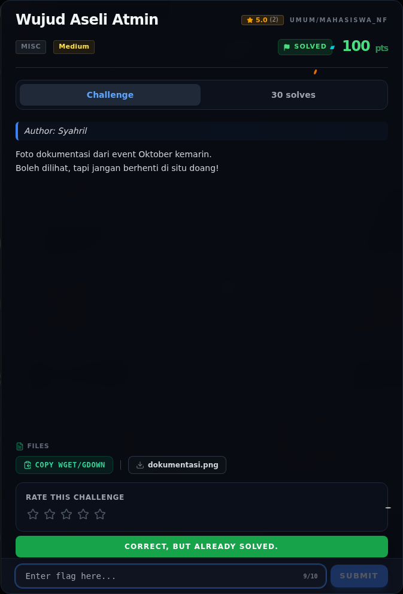

# Wujud Aseli Atmin

Track Mahasiswa NF · MiscMedium420 poinVERIFIED

| Field | Nilai |
|---|---|
| Event | `umum/mahasiswa_nf` |
| Kategori | `Misc` |
| Difficulty | `Medium` |
| Poin | `420` |
| Author | `Syahril` |
| Solves | `2 saat writeup dibuat` |
| Tools | binwalk, exiftool, zsteg, sage, z3, git |
| Flag | `NFX{NFCC_Goes_to_NCSC_2026}` |
| Status | `VERIFIED` |

[← Kembali ke Index](index.md)

## Challenge Brief (platform)

*Challenge brief asli di platform NFX CTF 2026.*

## Ringkasan

> Challenge baru di event umum (bukan extend), dibuat 2026-11-07 23:51.
> Attachment: `dokumentasi.png`.

Pratinjau evidence. Buka halaman <a href="52-wujud-aseli-atmin-06-bukti-evidence.html">Evidence / Bukti</a> untuk semua screenshot dan transkrip.

## Navigasi Halaman

<a class="nx-page-card" href="52-wujud-aseli-atmin-01-cerita-singkat.html"><b>Cerita Singkat</b>Konteks dan cerita challenge</a>
<a class="nx-page-card" href="52-wujud-aseli-atmin-02-recon.html"><b>Recon</b>Enumerasi target dan bukti awal</a>
<a class="nx-page-card" href="52-wujud-aseli-atmin-03-analisis.html"><b>Analisis</b>Membaca alur dan akar masalah</a>
<a class="nx-page-card" href="52-wujud-aseli-atmin-04-penyelesaian.html"><b>Penyelesaian</b>Baca bagian ini</a>
<a class="nx-page-card" href="52-wujud-aseli-atmin-05-flag.html"><b>Flag</b>Flag dan verifikasi platform</a>
<a class="nx-page-card" href="52-wujud-aseli-atmin-06-bukti-evidence.html"><b>Bukti / Evidence</b>Screenshot, transkrip, dan artefak</a>
<a class="nx-page-card" href="52-wujud-aseli-atmin-07-referensi.html"><b>Referensi</b>Sumber dan bacaan lanjutan</a>

