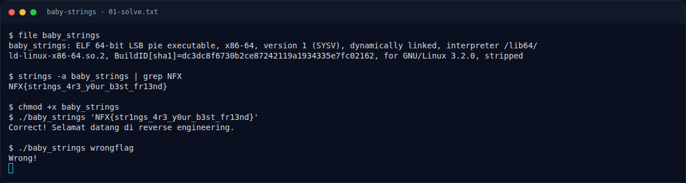

# Baby Strings — Recon

[← Overview](53-baby-strings.md) · [Index](index.md)

> **Langkah 1/6 — Recon.** Pertama kita cek dulu file-nya:
>
> **Titik penting:** file baby_strings · strings -a baby_strings \| grep NFX · NFX{str1ngs_4r3_y0ur_b3st_fr13nd}
>
> **Berikutnya:** [Analisis](53-baby-strings-02-analisis.md)

Pertama kita cek dulu file-nya:

```bash
file baby_strings
```

Output asli:

```text
baby_strings: ELF 64-bit LSB pie executable, x86-64, ... stripped
```

Binary ini stripped, tapi bukan berarti flagnya hilang. Kita coba tarik semua string yang ada:

```bash
strings -a baby_strings | grep NFX
```

Hasilnya:

```text
NFX{str1ngs_4r3_y0ur_b3st_fr13nd}
```

### Evidence langkah ini



*Terminal evidence — `01-solve.txt` (arsip transkrip sesi solve).*

**Berkas mentah langkah ini:**

- [`01-solve.txt`](assets/baby-strings/01-solve.txt)
