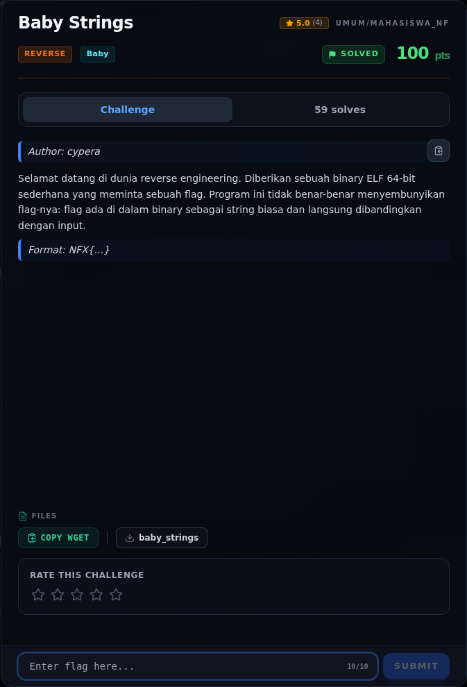

# Baby Strings — Analisis

[← Overview](53-baby-strings.md) · [Index](index.md)

> **Langkah 2/6 — Analisis.** Flag muncul langsung sebagai string biasa.
>
> **Titik penting:** Flag muncul langsung sebagai string biasa.
>
> **Berikutnya:** [Solver](53-baby-strings-03-solver.md)

Flag muncul langsung sebagai string biasa. Ini karena pembuat challenge menyimpan flag di `.rodata` dan membandingkannya dengan input tanpa obfuscation. Jadi tidak perlu decompile.

### Evidence langkah ini

*Challenge brief asli di platform NFX CTF 2026.*
