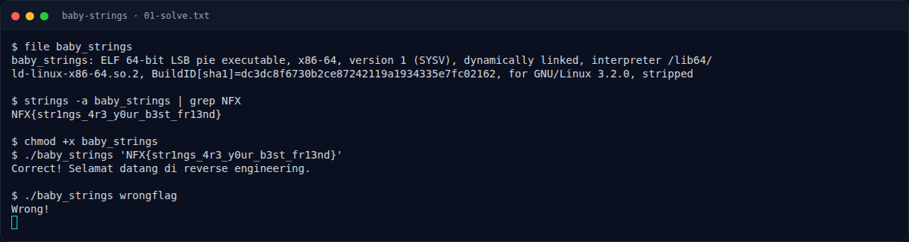

# Baby Strings — Solver

[← Overview](53-baby-strings.md) · [Index](index.md)

> **Langkah 3/6 — Solver.** Binary awalnya tidak executable, jadi kita kasih permission dulu, lalu jalankan dengan flag hasil strings:
>
> **Titik penting:** NFX{str1ngs_4r3_y0ur_b3st_fr13nd} · Correct! Selamat datang di reverse engineering.
>
> **Berikutnya:** [Flag](53-baby-strings-04-flag.md)

Binary awalnya tidak executable, jadi kita kasih permission dulu, lalu jalankan dengan flag hasil `strings`:

```bash
chmod +x baby_strings
./baby_strings 'NFX{str1ngs_4r3_y0ur_b3st_fr13nd}'
```

Output:

```text
Correct! Selamat datang di reverse engineering.
```

Kalau pakai flag salah:

```bash
./baby_strings wrongflag
```

Output:

```text
Wrong!
```

### Evidence langkah ini



*Terminal evidence — `01-solve.txt` (arsip transkrip sesi solve).*

**Berkas mentah langkah ini:**

- [`01-solve.txt`](assets/baby-strings/01-solve.txt)
