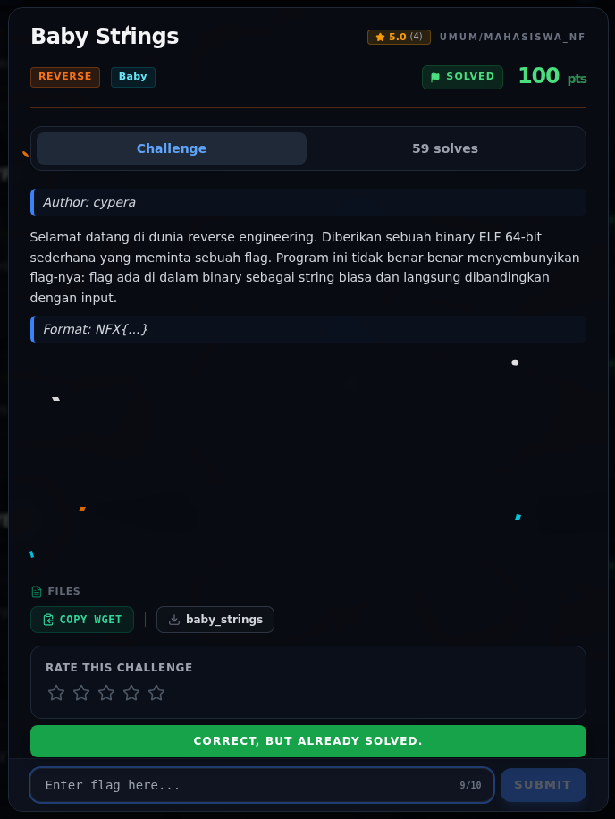

# Baby Strings — Flag & Verifikasi

[← Overview](53-baby-strings.md) · [Index](index.md)

> **Langkah 4/6 — Flag.** Flag
>
> **Titik penting:** NFX{str1ngs_4r3_y0ur_b3st_fr13nd}
>
> **Berikutnya:** [Bukti / Evidence](53-baby-strings-05-bukti-evidence.md)

> **Asal flag.** Flag diperoleh dari langkah exploit/solver yang terdokumentasi, lalu disubmit ke platform.  
> **Tingkat bukti metode.** Terdokumentasi. [Buka Evidence](53-baby-strings-05-bukti-evidence.md)

> **Status metode:** **FULL** — metode utama berhasil direproduksi.  
> **Flag:** `NFX{str1ngs_4r3_y0ur_b3st_fr13nd}`
> **Status:** `VERIFIED`

```text
NFX{str1ngs_4r3_y0ur_b3st_fr13nd}
```

### Terminal evidence (real)


*Terminal evidence (real).*

> **Bukti:** terminal evidence (real).

## Validasi platform (real)



*Screenshot asli dari platform NFX CTF 2026. Platform menjawab
`CORRECT, BUT ALREADY SOLVED.` untuk flag ini.*
