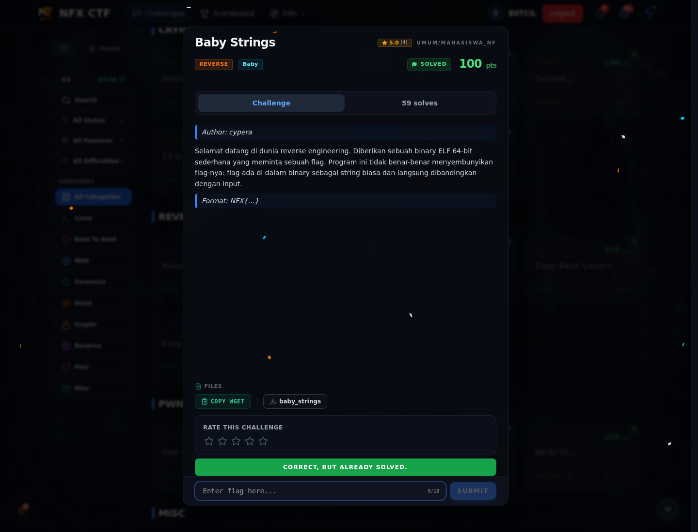

# Baby Strings — Flag & Verifikasi

[← Overview](53-baby-strings.md) · [Index](index.md)

> **Langkah 4/6 — Flag.** Flag
>
> **Titik penting:** NFX{str1ngs_4r3_y0ur_b3st_fr13nd}
>
> **Berikutnya:** [Bukti / Evidence](53-baby-strings-05-bukti-evidence.md)

> **Flag:** `NFX{str1ngs_4r3_y0ur_b3st_fr13nd}`
> **Status:** `VERIFIED`

```text
NFX{str1ngs_4r3_y0ur_b3st_fr13nd}
```

### Bukti submit di platform



*Submit flag di platform: `CORRECT, BUT ALREADY SOLVED.`*

> **Bukti submit:** screenshot form challenge di atas menampilkan `CORRECT, BUT ALREADY SOLVED.`
