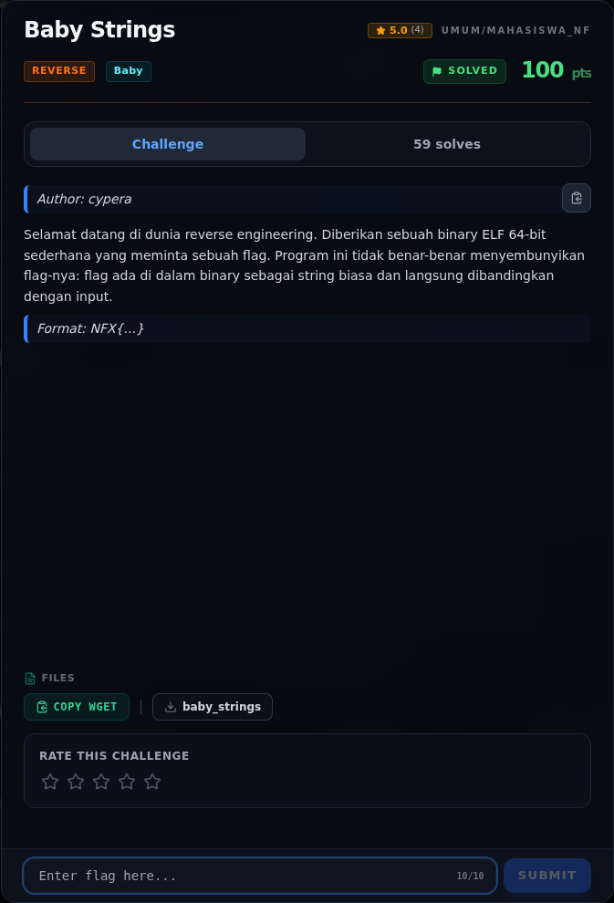
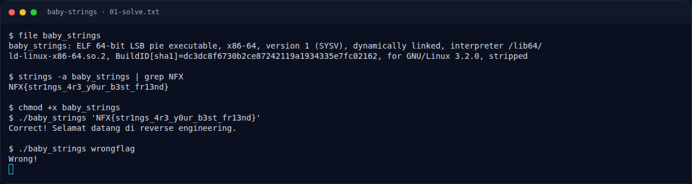

# Baby Strings

Track Mahasiswa NF · ReverseBaby200 poinVERIFIED

| Field | Nilai |
|---|---|
| Event | `umum/mahasiswa_nf` |
| Kategori | `Reverse` |
| Difficulty | `Baby` |
| Poin (snapshot) | `200` |
| Author | `cypera` |
| Tools | strings |
| Flag | `NFX{str1ngs_4r3_y0ur_b3st_fr13nd}` |
| Status | `VERIFIED` |
| Snapshot | 2026-11-13 |

[← Kembali ke Index](index.md)

## TL;DR

- **Flag:** `NFX{str1ngs_4r3_y0ur_b3st_fr13nd}`
- **Baca langkah lengkap:** [Cara Mendapatkan Flag](53-baby-strings-04-flag.md)

## Challenge Brief (platform)

*Challenge brief asli di platform NFX CTF 2026.*

## Alur & Titik Penting

| # | Langkah | Titik penting | Buka |
|---:|---|---|---|
| 1 | Recon | file baby_strings | [Buka](53-baby-strings-01-recon.md) |
| 2 | Analisis | Flag muncul langsung sebagai string biasa. | [Buka](53-baby-strings-02-analisis.md) |
| 3 | Solver | NFX{str1ngs_4r3_y0ur_b3st_fr13nd} | [Buka](53-baby-strings-03-solver.md) |
| 4 | Flag | NFX{str1ngs_4r3_y0ur_b3st_fr13nd} | [Buka](53-baby-strings-04-flag.md) |
| 5 | Bukti / Evidence | arsip screenshot dan transkrip | [Buka](53-baby-strings-05-bukti-evidence.md) |
| 6 | Referensi | — | [Buka](53-baby-strings-06-referensi.md) |

## Cerita singkat

Jadi ceritanya gini. Kita dikasih satu binary ELF kecil bernama `baby_strings`. Programnya cuma minta flag, lalu membandingkan input kita dengan flag yang tersimpan di dalam binary. Karena flagnya tidak dienkripsi, kita bisa langsung intip pakai `strings`.

Pratinjau evidence. Buka halaman <a href="53-baby-strings-05-bukti-evidence.html">Evidence / Bukti</a> untuk semua screenshot dan transkrip.

## Navigasi Halaman

<a class="nx-page-card" href="53-baby-strings-01-recon.html"><b>Recon</b>Enumerasi target dan bukti awal</a>
<a class="nx-page-card" href="53-baby-strings-02-analisis.html"><b>Analisis</b>Membaca alur dan akar masalah</a>
<a class="nx-page-card" href="53-baby-strings-03-solver.html"><b>Solver</b>Langkah exploit dan solver</a>
<a class="nx-page-card" href="53-baby-strings-04-flag.html"><b>Flag</b>Flag dan verifikasi platform</a>
<a class="nx-page-card" href="53-baby-strings-05-bukti-evidence.html"><b>Bukti / Evidence</b>Screenshot, transkrip, dan artefak</a>
<a class="nx-page-card" href="53-baby-strings-06-referensi.html"><b>Referensi</b>Sumber dan bacaan lanjutan</a>

