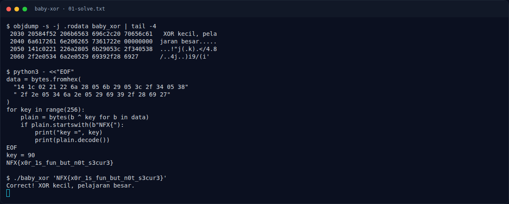

# Baby XOR — Recon

[← Overview](54-baby-xor.md) · [Index](index.md)

> **Langkah 1/6 — Recon.** Cek binary dan cari area data yang mencurigakan:
>
> **Titik penting:** file baby_xor · objdump -s -j .rodata baby_xor \| tail -4
>
> **Berikutnya:** [Analisis](54-baby-xor-02-analisis.md)

Cek binary dan cari area data yang mencurigakan:

```bash
file baby_xor
objdump -s -j .rodata baby_xor | tail -4
```

Di `.rodata` ada array byte setelah string pesan:

```text
2050 141c0221 226a2805 6b29053c 2f340538
2060 2f2e0534 6a2e0529 69392f28 6927
```

### Evidence langkah ini



*Terminal evidence — `01-solve.txt` (arsip transkrip sesi solve).*

**Berkas mentah langkah ini:**

- [`01-solve.txt`](assets/baby-xor/01-solve.txt)
