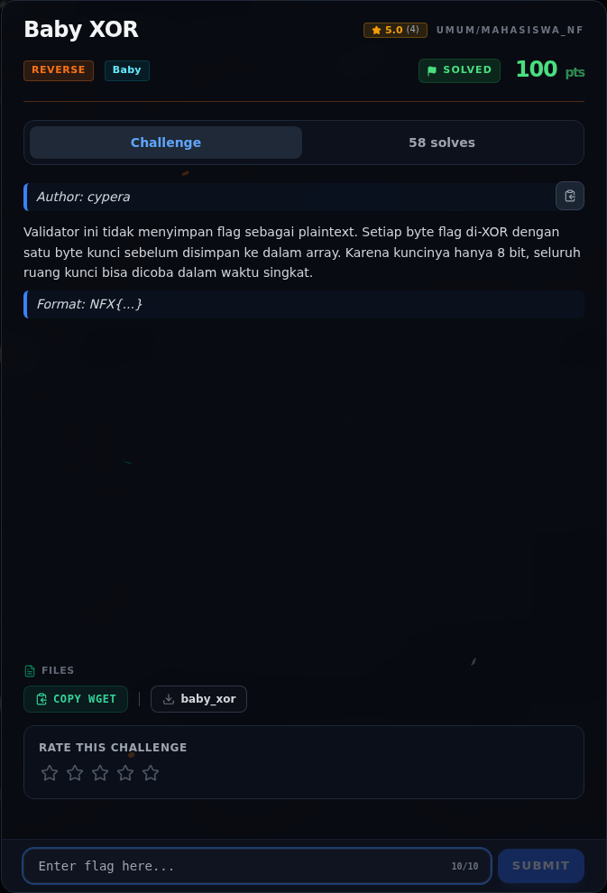

# Baby XOR — Analisis

[← Overview](54-baby-xor.md) · [Index](index.md)

> **Langkah 2/6 — Analisis.** Byte 14 1c 02 21 ...
>
> **Titik penting:** Byte 14 1c 02 21 ...
>
> **Berikutnya:** [Solver](54-baby-xor-03-solver.md)

Byte `14 1c 02 21 ...` bukan ASCII biasa. Karena deskripsi bilang XOR satu byte, kita brute force key `0..255` dan cek hasil yang diawali `NFX{`.

### Evidence langkah ini

*Challenge brief asli di platform NFX CTF 2026.*
