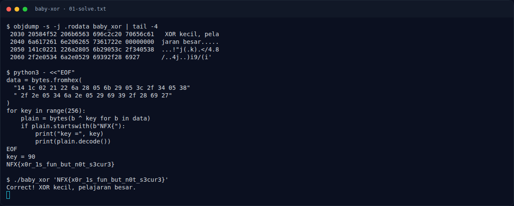

# Baby XOR — Solver

[← Overview](54-baby-xor.md) · [Index](index.md)

> **Langkah 3/6 — Solver.** Verifikasi ke binary:
>
> **Titik penting:** NFX{x0r_1s_fun_but_n0t_s3cur3} · Correct! XOR kecil, pelajaran besar.
>
> **Berikutnya:** [Flag](54-baby-xor-04-flag.md)

```python
data = bytes.fromhex(
    "14 1c 02 21 22 6a 28 05 6b 29 05 3c 2f 34 05 38"
    " 2f 2e 05 34 6a 2e 05 29 69 39 2f 28 69 27"
)
for key in range(256):
    plain = bytes(b ^ key for b in data)
    if plain.startswith(b"NFX{"):
        print("key =", key)
        print(plain.decode())
```

Output:

```text
key = 90
NFX{x0r_1s_fun_but_n0t_s3cur3}
```

Verifikasi ke binary:

```bash
./baby_xor 'NFX{x0r_1s_fun_but_n0t_s3cur3}'
```

```text
Correct! XOR kecil, pelajaran besar.
```

### Evidence langkah ini



*Terminal evidence — `01-solve.txt` (arsip transkrip sesi solve).*

**Berkas mentah langkah ini:**

- [`01-solve.txt`](assets/baby-xor/01-solve.txt)
