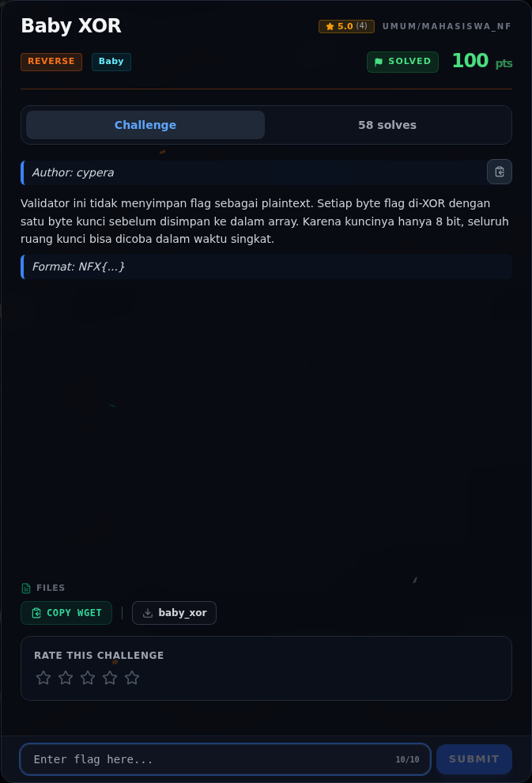
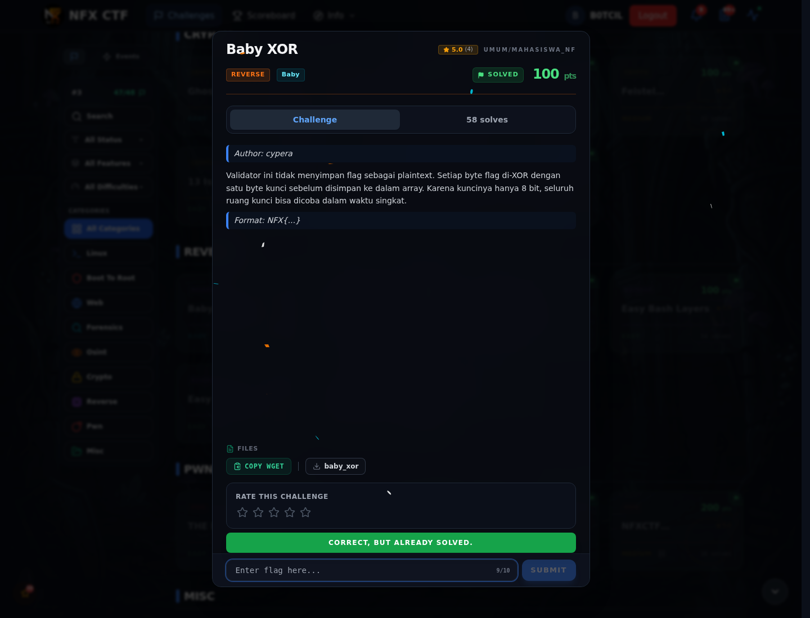

# Baby XOR

Track Mahasiswa NF · ReverseBaby260 poinVERIFIED

| Field | Nilai |
|---|---|
| Event | `umum/mahasiswa_nf` |
| Kategori | `Reverse` |
| Difficulty | `Baby` |
| Poin | `260` |
| Author | `cypera` |
| Tools | objdump |
| Flag | `NFX{x0r_1s_fun_but_n0t_s3cur3}` |
| Status | `VERIFIED` |

[← Kembali ke Index](index.md)

## Challenge Brief (platform)

*Challenge brief asli di platform NFX CTF 2026.*

## Alur & Titik Penting

| # | Langkah | Titik penting | Buka |
|---:|---|---|---|
| 1 | Recon | file baby_xor | [Buka](54-baby-xor-01-recon.md) |
| 2 | Analisis | Byte 14 1c 02 21 ... | [Buka](54-baby-xor-02-analisis.md) |
| 3 | Solver | NFX{x0r_1s_fun_but_n0t_s3cur3} | [Buka](54-baby-xor-03-solver.md) |
| 4 | Flag | NFX{x0r_1s_fun_but_n0t_s3cur3} | [Buka](54-baby-xor-04-flag.md) |
| 5 | Bukti / Evidence | arsip screenshot dan transkrip | [Buka](54-baby-xor-05-bukti-evidence.md) |
| 6 | Referensi | — | [Buka](54-baby-xor-06-referensi.md) |

## Cerita singkat

Jadi ceritanya gini. Kali ini flagnya tidak muncul sebagai plaintext. Binary menyimpan byte-byte hasil XOR dengan satu kunci 8-bit. Karena kuncinya cuma 0–255, kita bisa coba semua kemungkinan sampai keluar format `NFX{`.

Pratinjau evidence. Buka halaman <a href="54-baby-xor-05-bukti-evidence.html">Evidence / Bukti</a> untuk semua screenshot dan transkrip.

## Navigasi Halaman

<a class="nx-page-card" href="54-baby-xor-01-recon.html"><b>Recon</b>Enumerasi target dan bukti awal</a>
<a class="nx-page-card" href="54-baby-xor-02-analisis.html"><b>Analisis</b>Membaca alur dan akar masalah</a>
<a class="nx-page-card" href="54-baby-xor-03-solver.html"><b>Solver</b>Langkah exploit dan solver</a>
<a class="nx-page-card" href="54-baby-xor-04-flag.html"><b>Flag</b>Flag dan verifikasi platform</a>
<a class="nx-page-card" href="54-baby-xor-05-bukti-evidence.html"><b>Bukti / Evidence</b>Screenshot, transkrip, dan artefak</a>
<a class="nx-page-card" href="54-baby-xor-06-referensi.html"><b>Referensi</b>Sumber dan bacaan lanjutan</a>

