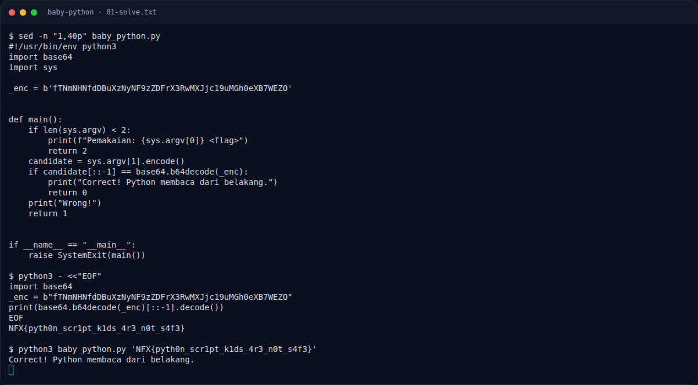

# Baby Python — Recon

[← Overview](55-baby-python.md) · [Index](index.md)

> **Langkah 1/6 — Recon.** Recon
>
> **Titik penting:** —
>
> **Berikutnya:** [Analisis](55-baby-python-02-analisis.md)

Buka script-nya:

```bash
sed -n '1,40p' baby_python.py
```

Bagian pentingnya:

```python
_enc = b'fTNmNHNfdDBuXzNyNF9zZDFrX3RwMXJjc19uMGh0eXB7WEZO'

candidate = sys.argv[1].encode()
if candidate[::-1] == base64.b64decode(_enc):
    print("Correct! Python membaca dari belakang.")
```

### Evidence langkah ini



*Terminal evidence — `01-solve.txt` (arsip transkrip sesi solve).*

**Berkas mentah langkah ini:**

- [`01-solve.txt`](assets/baby-python/01-solve.txt)
