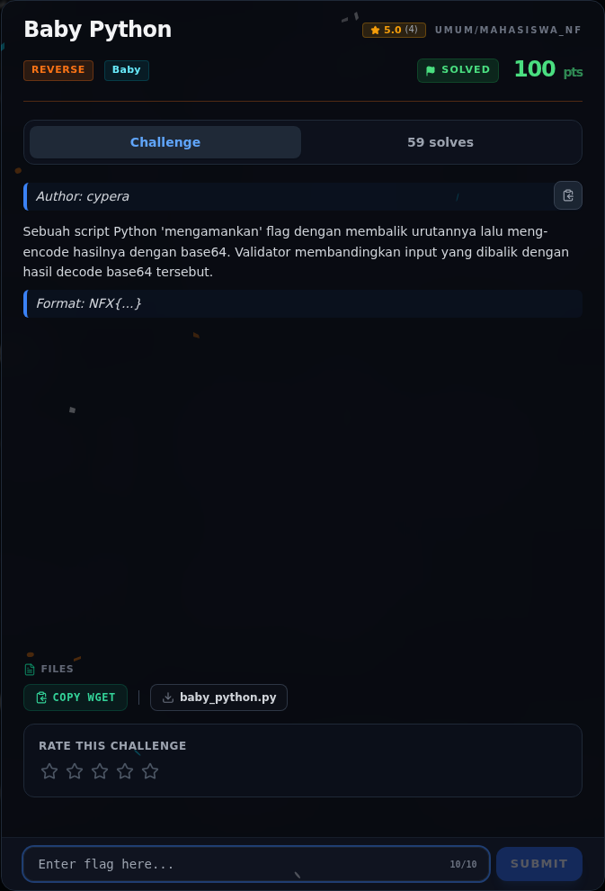

# Baby Python — Analisis

[← Overview](55-baby-python.md) · [Index](index.md)

> **Langkah 2/6 — Analisis.** candidate[::-1] berarti input dibalik.
>
> **Titik penting:** candidate[::-1] berarti input dibalik.
>
> **Berikutnya:** [Solver](55-baby-python-03-solver.md)

`candidate[::-1]` berarti input dibalik. Jadi untuk mendapatkan flag, kita decode base64 `_enc`, lalu balik string hasilnya.

### Evidence langkah ini

*Challenge brief asli di platform NFX CTF 2026.*
