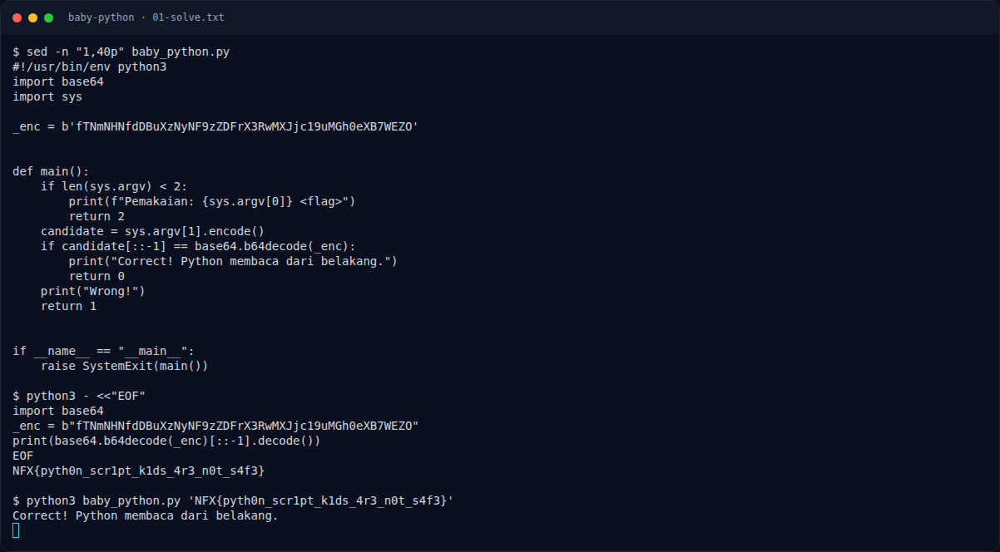

# Baby Python — Solver

[← Overview](55-baby-python.md) · [Index](index.md)

> **Langkah 3/6 — Solver.** Solver
>
> **Titik penting:** python3 baby_python.py 'NFX{pyth0n_scr1pt_k1ds_4r3_n0t_s4f3}' · Correct! Python membaca dari belakang. · NFX{pyth0n_scr1pt_k1ds_4r3_n0t_s4f3}
>
> **Berikutnya:** [Flag](55-baby-python-04-flag.md)

```python
import base64
_enc = b"fTNmNHNfdDBuXzNyNF9zZDFrX3RwMXJjc19uMGh0eXB7WEZO"
print(base64.b64decode(_enc)[::-1].decode())
```

Output:

```text
NFX{pyth0n_scr1pt_k1ds_4r3_n0t_s4f3}
```

Verifikasi:

```bash
python3 baby_python.py 'NFX{pyth0n_scr1pt_k1ds_4r3_n0t_s4f3}'
```

```text
Correct! Python membaca dari belakang.
```

### Evidence langkah ini



*Terminal evidence — `01-solve.txt` (arsip transkrip sesi solve).*

**Berkas mentah langkah ini:**

- [`01-solve.txt`](assets/baby-python/01-solve.txt)
