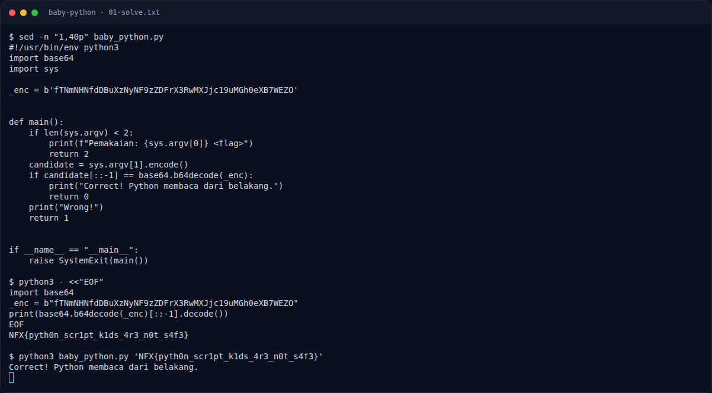

# Baby Python — Flag & Verifikasi

[← Overview](55-baby-python.md) · [Index](index.md)

> **Langkah 4/6 — Flag.** Flag
>
> **Titik penting:** NFX{pyth0n_scr1pt_k1ds_4r3_n0t_s4f3}
>
> **Berikutnya:** [Bukti / Evidence](55-baby-python-05-bukti-evidence.md)

> **Flag:** `NFX{pyth0n_scr1pt_k1ds_4r3_n0t_s4f3}`
> **Status:** `VERIFIED`

```text
NFX{pyth0n_scr1pt_k1ds_4r3_n0t_s4f3}
```

### Terminal evidence (real)



*Terminal evidence (real).*

> **Bukti:** terminal evidence (real).
