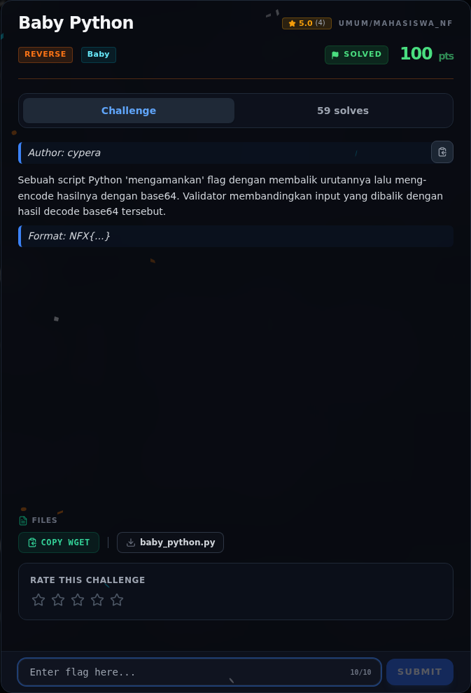

# Baby Python — Referensi

[← Overview](55-baby-python.md) · [Index](index.md)

> **Langkah 6/6 — Referensi.** Referensi
>
> **Titik penting:** —
>
> **Selesai.** Kembali ke [Overview](55-baby-python.md).

- Python `base64.b64decode`.
- Slice `[::-1]` untuk membalik string.

### Evidence langkah ini

*Challenge brief asli di platform NFX CTF 2026.*
