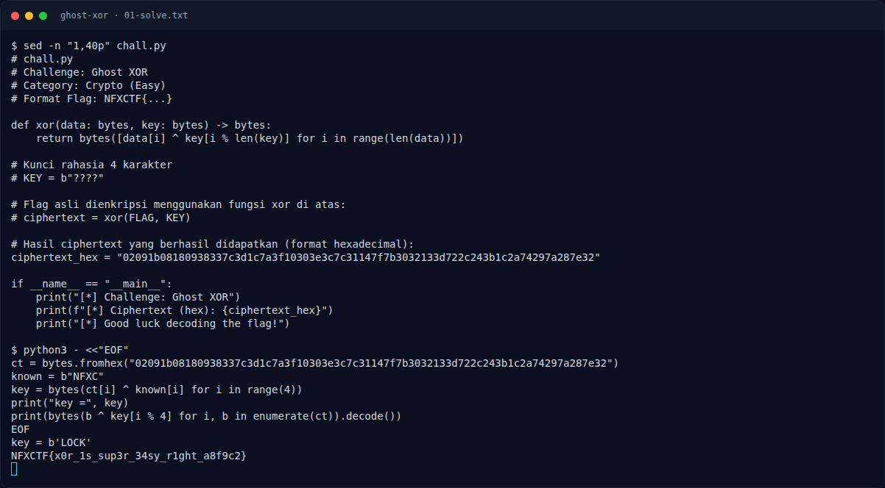

# Ghost XOR — Recon

[← Overview](56-ghost-xor.md) · [Index](index.md)

> **Langkah 1/6 — Recon.** Recon
>
> **Titik penting:** —
>
> **Berikutnya:** [Analisis](56-ghost-xor-02-analisis.md)

Source challenge:

```bash
sed -n '1,40p' chall.py
```

Isinya:

```python
def xor(data: bytes, key: bytes) -> bytes:
    return bytes([data[i] ^ key[i % len(key)] for i in range(len(data))])

ciphertext_hex = "02091b08180938337c3d1c7a3f10303e3c7c31147f7b3032133d722c243b1c2a74297a287e32"
```

### Evidence langkah ini



*Terminal evidence — `01-solve.txt` (arsip transkrip sesi solve).*

**Berkas mentah langkah ini:**

- [`01-solve.txt`](assets/ghost-xor/01-solve.txt)
