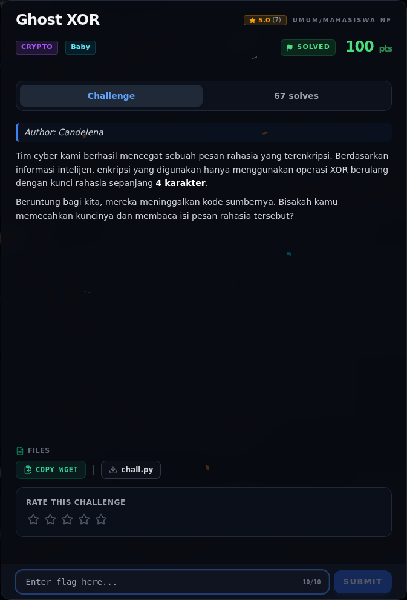

# Ghost XOR — Analisis

[← Overview](56-ghost-xor.md) · [Index](index.md)

> **Langkah 2/6 — Analisis.** Analisis
>
> **Titik penting:** —
>
> **Berikutnya:** [Solver](56-ghost-xor-03-solver.md)

Kunci panjangnya 4. Empat byte pertama plaintext pasti `NFXC` (awal `NFXCTF{`). Maka:

```text
key = ciphertext[0:4] XOR "NFXC"
```

### Evidence langkah ini



*Challenge brief asli di platform NFX CTF 2026.*
