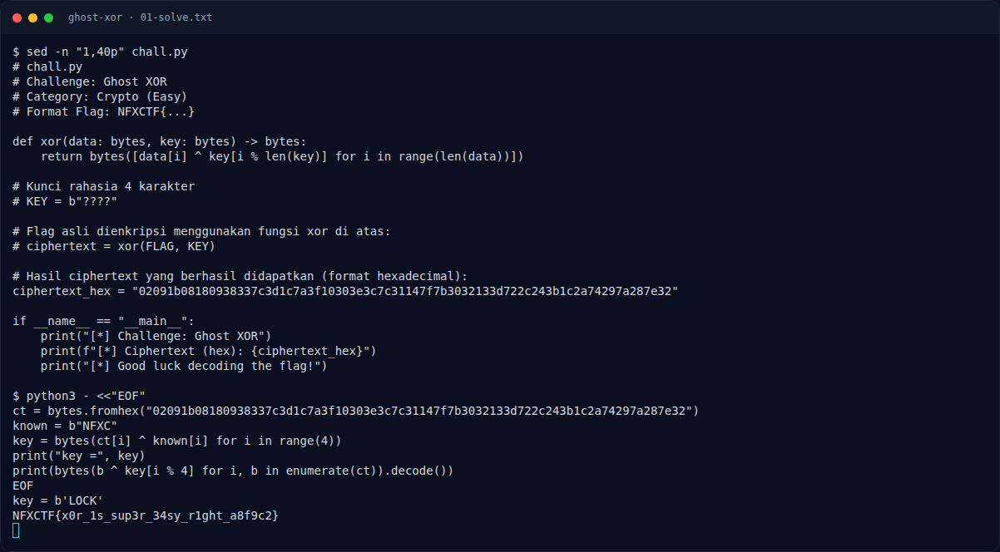

# Ghost XOR — Solver

[← Overview](56-ghost-xor.md) · [Index](index.md)

> **Langkah 3/6 — Solver.** Solver
>
> **Titik penting:** NFXCTF{x0r_1s_sup3r_34sy_r1ght_a8f9c2}
>
> **Berikutnya:** [Flag](56-ghost-xor-04-flag.md)

```python
ct = bytes.fromhex("02091b08180938337c3d1c7a3f10303e3c7c31147f7b3032133d722c243b1c2a74297a287e32")
known = b"NFXC"
key = bytes(ct[i] ^ known[i] for i in range(4))
print("key =", key)
print(bytes(b ^ key[i % 4] for i, b in enumerate(ct)).decode())
```

Output:

```text
key = b'LOCK'
NFXCTF{x0r_1s_sup3r_34sy_r1ght_a8f9c2}
```

### Evidence langkah ini



*Terminal evidence — `01-solve.txt` (arsip transkrip sesi solve).*

**Berkas mentah langkah ini:**

- [`01-solve.txt`](assets/ghost-xor/01-solve.txt)
