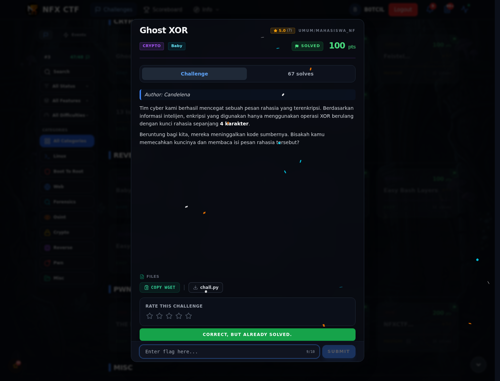

# Ghost XOR — Flag & Verifikasi

[← Overview](56-ghost-xor.md) · [Index](index.md)

> **Langkah 4/6 — Flag.** Flag
>
> **Titik penting:** NFXCTF{x0r_1s_sup3r_34sy_r1ght_a8f9c2}
>
> **Berikutnya:** [Bukti / Evidence](56-ghost-xor-05-bukti-evidence.md)

> **Flag:** `NFXCTF{x0r_1s_sup3r_34sy_r1ght_a8f9c2}`
> **Status:** `VERIFIED`

```text
NFXCTF{x0r_1s_sup3r_34sy_r1ght_a8f9c2}
```

### Bukti submit di platform



*Submit flag di platform: `CORRECT, BUT ALREADY SOLVED.`*

> **Bukti submit:** screenshot form challenge di atas menampilkan `CORRECT, BUT ALREADY SOLVED.`
