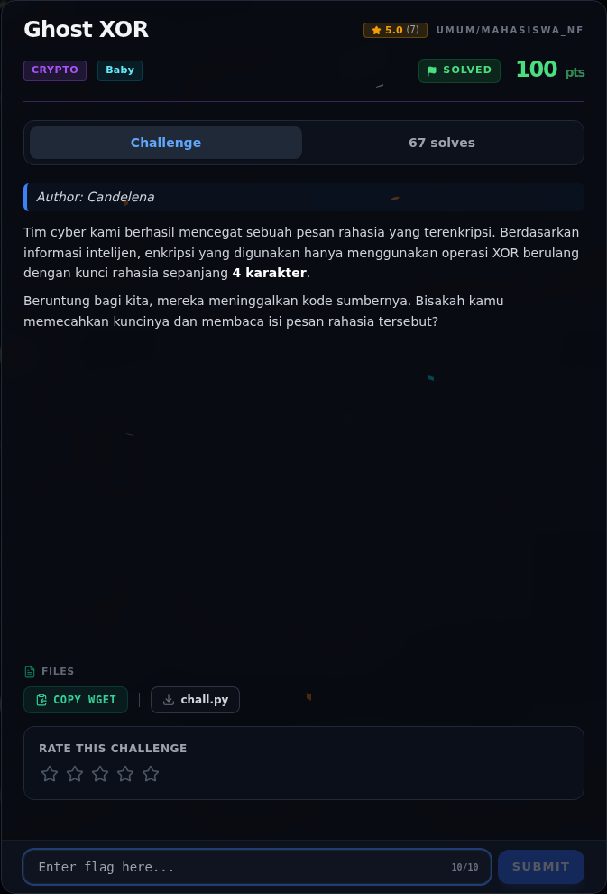
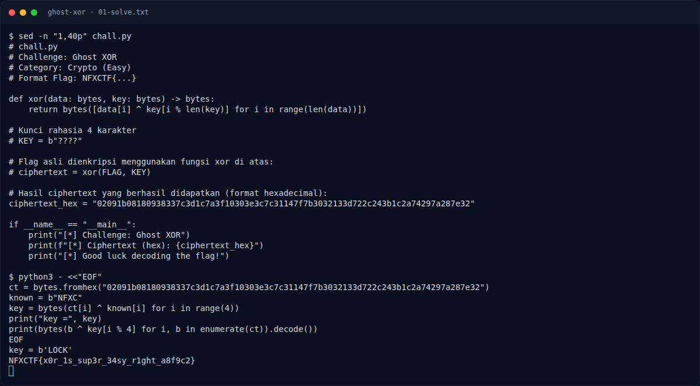

# Ghost XOR

Track Mahasiswa NF · CryptoBaby100 poinVERIFIED

| Field | Nilai |
|---|---|
| Event | `umum/mahasiswa_nf` |
| Kategori | `Crypto` |
| Difficulty | `Baby` |
| Poin (snapshot) | `100` |
| Author | `Candelena` |
| Flag | `NFXCTF{x0r_1s_sup3r_34sy_r1ght_a8f9c2}` |
| Status | `VERIFIED` |
| Snapshot | 2026-11-13 |

[← Kembali ke Index](index.md)

## TL;DR

- **Flag:** `NFXCTF{x0r_1s_sup3r_34sy_r1ght_a8f9c2}`
- **Baca langkah lengkap:** [Cara Mendapatkan Flag](56-ghost-xor-04-flag.md)

## Challenge Brief (platform)

*Challenge brief asli di platform NFX CTF 2026.*

## Alur & Titik Penting

| # | Langkah | Titik penting | Buka |
|---:|---|---|---|
| 1 | Recon | — | [Buka](56-ghost-xor-01-recon.md) |
| 2 | Analisis | — | [Buka](56-ghost-xor-02-analisis.md) |
| 3 | Solver | NFXCTF{x0r_1s_sup3r_34sy_r1ght_a8f9c2} | [Buka](56-ghost-xor-03-solver.md) |
| 4 | Flag | NFXCTF{x0r_1s_sup3r_34sy_r1ght_a8f9c2} | [Buka](56-ghost-xor-04-flag.md) |
| 5 | Bukti / Evidence | arsip screenshot dan transkrip | [Buka](56-ghost-xor-05-bukti-evidence.md) |
| 6 | Referensi | — | [Buka](56-ghost-xor-06-referensi.md) |

## Cerita singkat

Jadi ceritanya gini. Kita punya ciphertext XOR dengan kunci 4 karakter. Karena format flag-nya sudah diketahui (`NFXCTF{`), kita bisa nebak 4 byte pertama plaintext, XOR dengan ciphertext, dan langsung dapat kuncinya.

Pratinjau evidence. Buka halaman <a href="56-ghost-xor-05-bukti-evidence.html">Evidence / Bukti</a> untuk semua screenshot dan transkrip.

## Navigasi Halaman

<a class="nx-page-card" href="56-ghost-xor-01-recon.html"><b>Recon</b>Enumerasi target dan bukti awal</a>
<a class="nx-page-card" href="56-ghost-xor-02-analisis.html"><b>Analisis</b>Membaca alur dan akar masalah</a>
<a class="nx-page-card" href="56-ghost-xor-03-solver.html"><b>Solver</b>Langkah exploit dan solver</a>
<a class="nx-page-card" href="56-ghost-xor-04-flag.html"><b>Flag</b>Flag dan verifikasi platform</a>
<a class="nx-page-card" href="56-ghost-xor-05-bukti-evidence.html"><b>Bukti / Evidence</b>Screenshot, transkrip, dan artefak</a>
<a class="nx-page-card" href="56-ghost-xor-06-referensi.html"><b>Referensi</b>Sumber dan bacaan lanjutan</a>

