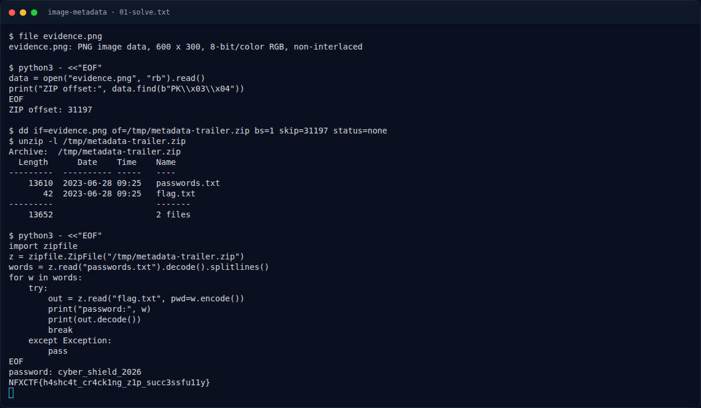

# Image Metadata — Recon Artefak

[← Overview](57-image-metadata.md) · [Index](index.md)

> **Langkah 1/6 — Recon Artefak.** Cari tanda ZIP di dalam file:
>
> **Titik penting:** file evidence.png
>
> **Berikutnya:** [Analisis Artefak](57-image-metadata-02-analisis-artefak.md)

Cek tipe file:

```bash
file evidence.png
```

```text
evidence.png: PNG image data, 600 x 300, 8-bit/color RGB, non-interlaced
```

Cari tanda ZIP di dalam file:

```python
data = open("evidence.png", "rb").read()
print("ZIP offset:", data.find(b"PK\x03\x04"))
```

```text
ZIP offset: 31197
```

### Evidence langkah ini



*Terminal evidence — `01-solve.txt` (arsip transkrip sesi solve).*

**Berkas mentah langkah ini:**

- [`01-solve.txt`](assets/image-metadata/01-solve.txt)
