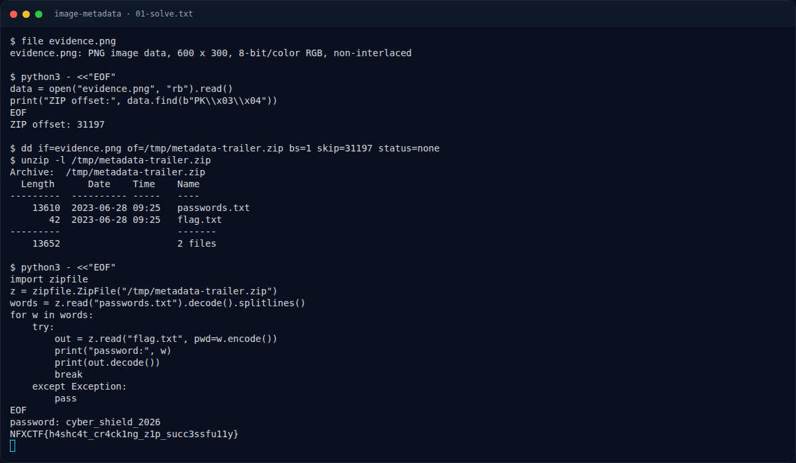

# Image Metadata — Pemulihan Artefak

[← Overview](57-image-metadata.md) · [Index](index.md)

> **Langkah 3/6 — Pemulihan Artefak.** Coba password satu per satu:
>
> **Titik penting:** NFXCTF{h4shc4t_cr4ck1ng_z1p_succ3ssfu11y}
>
> **Berikutnya:** [Flag](57-image-metadata-04-flag.md)

Coba password satu per satu:

```python
import zipfile
z = zipfile.ZipFile("/tmp/metadata-trailer.zip")
words = z.read("passwords.txt").decode().splitlines()
for w in words:
    try:
        out = z.read("flag.txt", pwd=w.encode())
        print("password:", w)
        print(out.decode())
        break
    except Exception:
        pass
```

Output:

```text
password: cyber_shield_2026
NFXCTF{h4shc4t_cr4ck1ng_z1p_succ3ssfu11y}
```

### Evidence langkah ini



*Terminal evidence — `01-solve.txt` (arsip transkrip sesi solve).*

**Berkas mentah langkah ini:**

- [`01-solve.txt`](assets/image-metadata/01-solve.txt)
