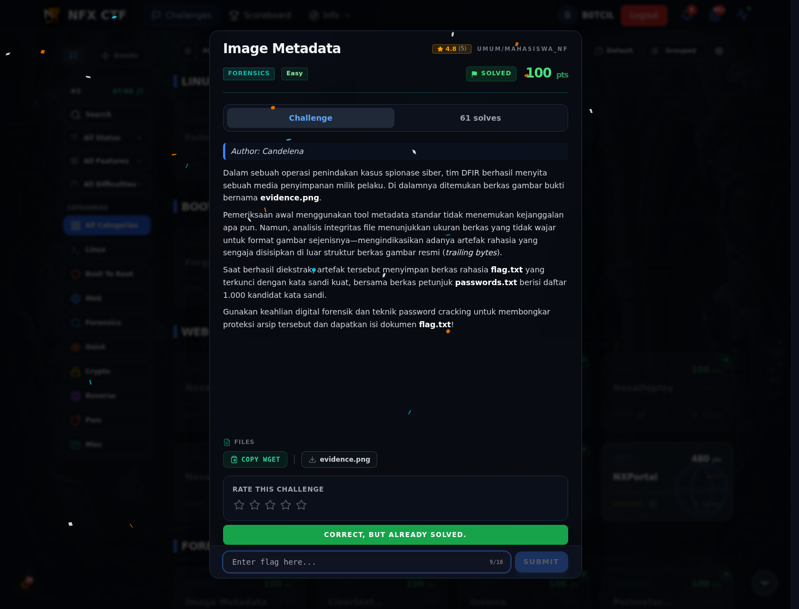

# Image Metadata — Flag & Verifikasi

[← Overview](57-image-metadata.md) · [Index](index.md)

> **Langkah 4/6 — Flag.** Flag
>
> **Titik penting:** NFXCTF{h4shc4t_cr4ck1ng_z1p_succ3ssfu11y}
>
> **Berikutnya:** [Bukti / Evidence](57-image-metadata-05-bukti-evidence.md)

> **Flag:** `NFXCTF{h4shc4t_cr4ck1ng_z1p_succ3ssfu11y}`
> **Status:** `VERIFIED`

```text
NFXCTF{h4shc4t_cr4ck1ng_z1p_succ3ssfu11y}
```

### Bukti submit di platform



*Submit flag di platform: `CORRECT, BUT ALREADY SOLVED.`*

> **Bukti submit:** screenshot form challenge di atas menampilkan `CORRECT, BUT ALREADY SOLVED.`
