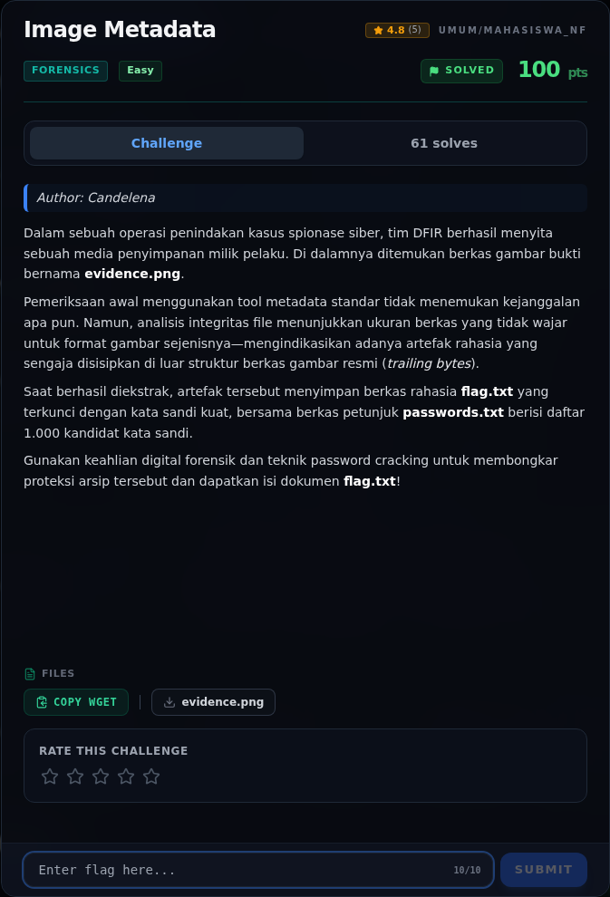

# Image Metadata — Referensi

[← Overview](57-image-metadata.md) · [Index](index.md)

> **Langkah 6/6 — Referensi.** Referensi
>
> **Titik penting:** —
>
> **Selesai.** Kembali ke [Overview](57-image-metadata.md).

- ZIP local file header `PK\x03\x04`.
- `zipfile.ZipFile.read(..., pwd=...)`.

### Evidence langkah ini

*Challenge brief asli di platform NFX CTF 2026.*
