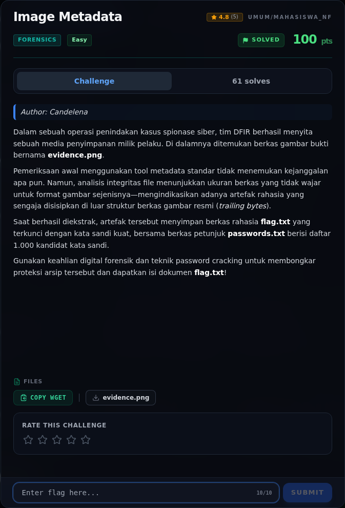
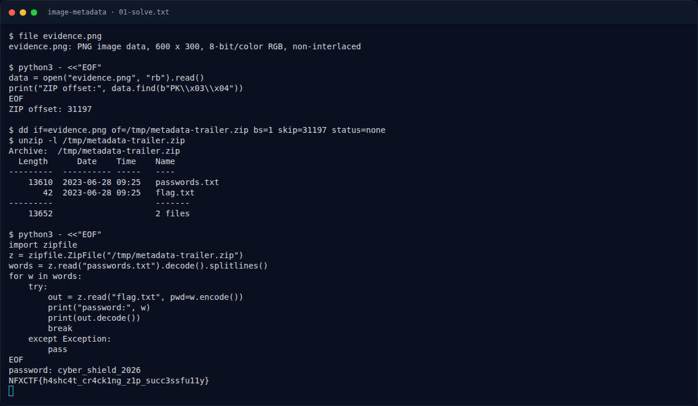

# Image Metadata

Track Mahasiswa NF · ForensicsEasy220 poinVERIFIED

| Field | Nilai |
|---|---|
| Event | `umum/mahasiswa_nf` |
| Kategori | `Forensics` |
| Difficulty | `Easy` |
| Poin (snapshot) | `220` |
| Author | `Candelena` |
| Flag | `NFXCTF{h4shc4t_cr4ck1ng_z1p_succ3ssfu11y}` |
| Status | `VERIFIED` |
| Snapshot | 2026-11-13 |

[← Kembali ke Index](index.md)

## TL;DR

- **Flag:** `NFXCTF{h4shc4t_cr4ck1ng_z1p_succ3ssfu11y}`
- **Baca langkah lengkap:** [Cara Mendapatkan Flag](57-image-metadata-04-flag.md)

## Challenge Brief (platform)

*Challenge brief asli di platform NFX CTF 2026.*

## Alur & Titik Penting

| # | Langkah | Titik penting | Buka |
|---:|---|---|---|
| 1 | Recon Artefak | file evidence.png | [Buka](57-image-metadata-01-recon-artefak.md) |
| 2 | Analisis Artefak | ZIP mulai di offset 31197. | [Buka](57-image-metadata-02-analisis-artefak.md) |
| 3 | Pemulihan Artefak | NFXCTF{h4shc4t_cr4ck1ng_z1p_succ3ssfu11y} | [Buka](57-image-metadata-03-pemulihan-artefak.md) |
| 4 | Flag | NFXCTF{h4shc4t_cr4ck1ng_z1p_succ3ssfu11y} | [Buka](57-image-metadata-04-flag.md) |
| 5 | Bukti / Evidence | arsip screenshot dan transkrip | [Buka](57-image-metadata-05-bukti-evidence.md) |
| 6 | Referensi | — | [Buka](57-image-metadata-06-referensi.md) |

## Cerita singkat

Jadi ceritanya gini. Kita dikasih satu gambar `evidence.png`. Kalau dilihat biasa, ya cuma gambar. Tapi setelah dicek, ada ZIP yang nyempil di belakang file PNG. ZIP-nya berisi `passwords.txt` dan `flag.txt` yang dikunci password. Kita tinggal coba daftar password itu sampai ketemu yang cocok.

Pratinjau evidence. Buka halaman <a href="57-image-metadata-05-bukti-evidence.html">Evidence / Bukti</a> untuk semua screenshot dan transkrip.

## Navigasi Halaman

<a class="nx-page-card" href="57-image-metadata-01-recon-artefak.html"><b>Recon Artefak</b>Enumerasi target dan bukti awal</a>
<a class="nx-page-card" href="57-image-metadata-02-analisis-artefak.html"><b>Analisis Artefak</b>Membaca alur dan akar masalah</a>
<a class="nx-page-card" href="57-image-metadata-03-pemulihan-artefak.html"><b>Pemulihan Artefak</b>Baca bagian ini</a>
<a class="nx-page-card" href="57-image-metadata-04-flag.html"><b>Flag</b>Flag dan verifikasi platform</a>
<a class="nx-page-card" href="57-image-metadata-05-bukti-evidence.html"><b>Bukti / Evidence</b>Screenshot, transkrip, dan artefak</a>
<a class="nx-page-card" href="57-image-metadata-06-referensi.html"><b>Referensi</b>Sumber dan bacaan lanjutan</a>

