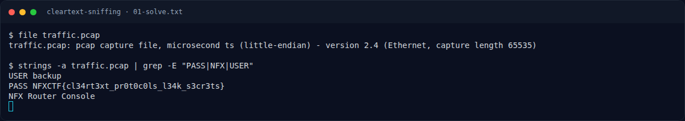

# Cleartext Sniffing — Recon Artefak

[← Overview](58-cleartext-sniffing.md) · [Index](index.md)

> **Langkah 1/6 — Recon Artefak.** Recon Artefak
>
> **Titik penting:** file traffic.pcap
>
> **Berikutnya:** [Analisis Artefak](58-cleartext-sniffing-02-analisis-artefak.md)

Cek file:

```bash
file traffic.pcap
```

```text
traffic.pcap: pcap capture file, microsecond ts (little-endian) - version 2.4 (Ethernet, capture length 65535)
```

### Evidence langkah ini



*Terminal evidence — `01-solve.txt` (arsip transkrip sesi solve).*

**Berkas mentah langkah ini:**

- [`01-solve.txt`](assets/cleartext-sniffing/01-solve.txt)
