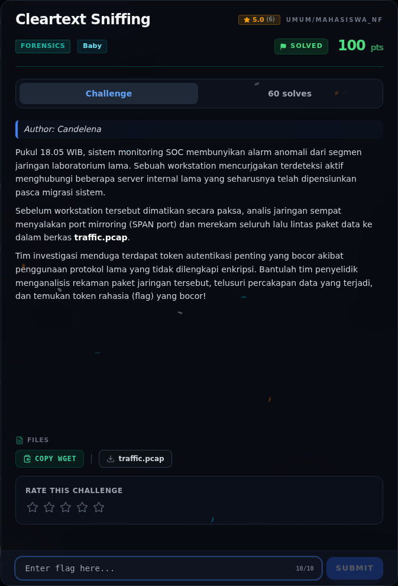

# Cleartext Sniffing — Analisis Artefak

[← Overview](58-cleartext-sniffing.md) · [Index](index.md)

> **Langkah 2/6 — Analisis Artefak.** Karena protokolnya cleartext, kita bisa tarik string dari pcap:
>
> **Titik penting:** strings -a traffic.pcap \| grep -E "PASS\|NFX\|USER" · NFXCTF{cl34rt3xt_pr0t0c0ls_l34k_s3cr3ts} · NFX Router Console
>
> **Berikutnya:** [Pemulihan Artefak](58-cleartext-sniffing-03-pemulihan-artefak.md)

Karena protokolnya cleartext, kita bisa tarik string dari pcap:

```bash
strings -a traffic.pcap | grep -E "PASS|NFX|USER"
```

```text
USER backup
PASS NFXCTF{cl34rt3xt_pr0t0c0ls_l34k_s3cr3ts}
NFX Router Console
```

### Evidence langkah ini



*Challenge brief asli di platform NFX CTF 2026.*
