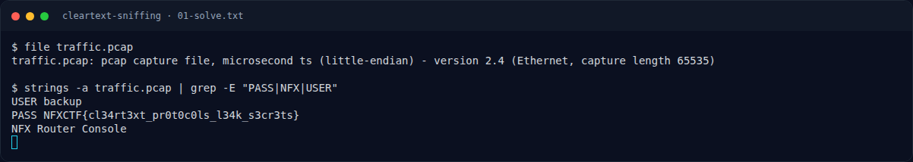

# Cleartext Sniffing — Pemulihan Artefak

[← Overview](58-cleartext-sniffing.md) · [Index](index.md)

> **Langkah 3/6 — Pemulihan Artefak.** Flag langsung terlihat di baris PASS.
>
> **Titik penting:** Flag langsung terlihat di baris PASS.
>
> **Berikutnya:** [Flag](58-cleartext-sniffing-04-flag.md)

Flag langsung terlihat di baris `PASS`. Tidak perlu dekripsi.

### Evidence langkah ini

*Terminal evidence — `01-solve.txt` (arsip transkrip sesi solve).*

**Berkas mentah langkah ini:**

- [`01-solve.txt`](assets/cleartext-sniffing/01-solve.txt)
