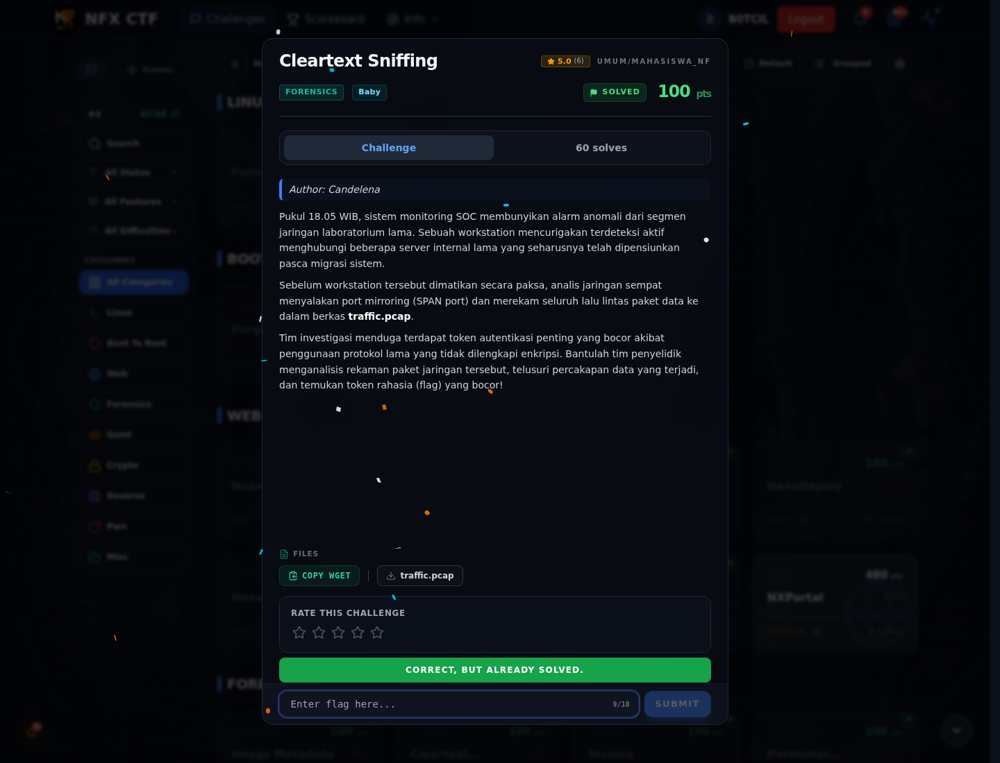

# Cleartext Sniffing — Flag & Verifikasi

[← Overview](58-cleartext-sniffing.md) · [Index](index.md)

> **Langkah 4/6 — Flag.** Flag
>
> **Titik penting:** NFXCTF{cl34rt3xt_pr0t0c0ls_l34k_s3cr3ts}
>
> **Berikutnya:** [Bukti / Evidence](58-cleartext-sniffing-05-bukti-evidence.md)

> **Flag:** `NFXCTF{cl34rt3xt_pr0t0c0ls_l34k_s3cr3ts}`
> **Status:** `VERIFIED`

```text
NFXCTF{cl34rt3xt_pr0t0c0ls_l34k_s3cr3ts}
```

### Bukti submit di platform



*Submit flag di platform: `CORRECT, BUT ALREADY SOLVED.`*

> **Bukti submit:** screenshot form challenge di atas menampilkan `CORRECT, BUT ALREADY SOLVED.`
