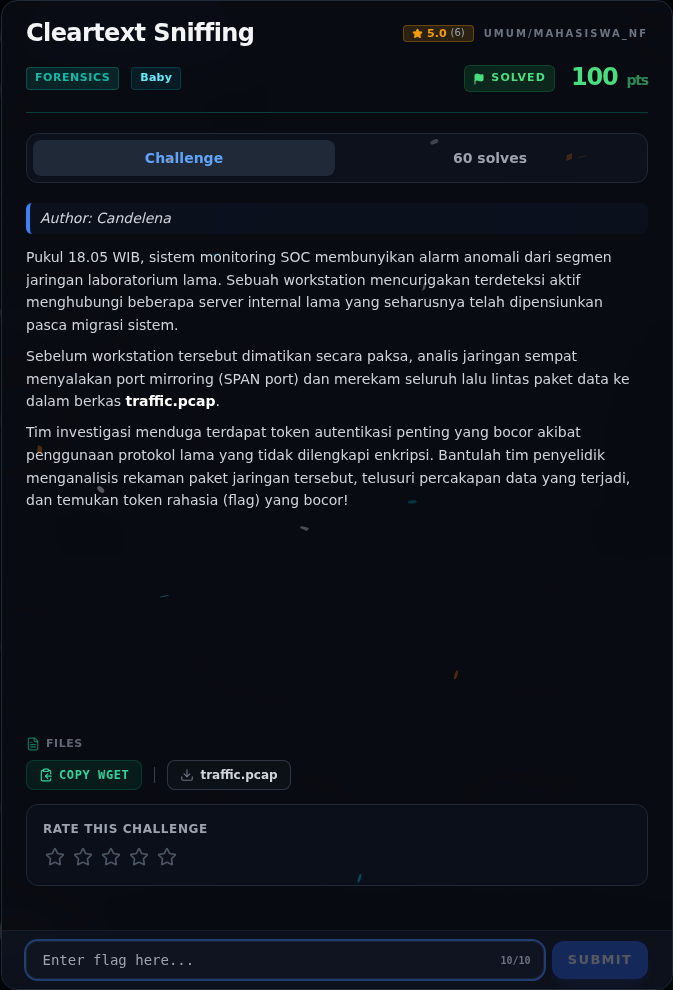

# Cleartext Sniffing — Referensi

[← Overview](58-cleartext-sniffing.md) · [Index](index.md)

> **Langkah 6/6 — Referensi.** Referensi
>
> **Titik penting:** —
>
> **Selesai.** Kembali ke [Overview](58-cleartext-sniffing.md).

- Analisis pcap dengan `strings` untuk protokol cleartext.
- Protokol lama: Telnet/FTP/HTTP tanpa TLS.

### Evidence langkah ini

*Challenge brief asli di platform NFX CTF 2026.*
