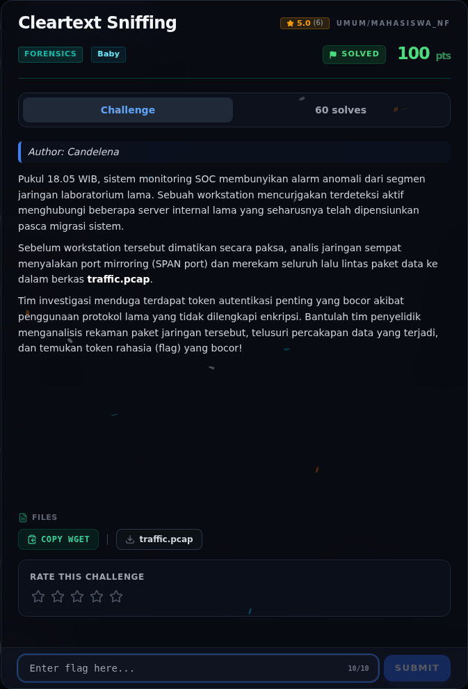
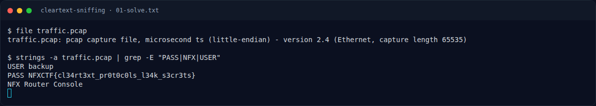

# Cleartext Sniffing

Track Mahasiswa NF · ForensicsBaby180 poinVERIFIED

| Field | Nilai |
|---|---|
| Event | `umum/mahasiswa_nf` |
| Kategori | `Forensics` |
| Difficulty | `Baby` |
| Poin (snapshot) | `180` |
| Author | `Candelena` |
| Tools | strings |
| Flag | `NFXCTF{cl34rt3xt_pr0t0c0ls_l34k_s3cr3ts}` |
| Status | `VERIFIED` |
| Metode | **FULL** — metode utama berhasil direproduksi. |
| Snapshot | 2026-11-13 |

[← Kembali ke Index](index.md)

## TL;DR

- **Flag:** `NFXCTF{cl34rt3xt_pr0t0c0ls_l34k_s3cr3ts}`
- **Metode:** **FULL** — metode utama berhasil direproduksi.
- **Baca langkah lengkap:** [Cara Mendapatkan Flag](58-cleartext-sniffing-04-flag.md)

## Challenge Brief (platform)

*Challenge brief asli di platform NFX CTF 2026.*

## Alur & Titik Penting

| # | Langkah | Titik penting | Buka |
|---:|---|---|---|
| 1 | Recon Artefak | file traffic.pcap | [Buka](58-cleartext-sniffing-01-recon-artefak.md) |
| 2 | Analisis Artefak | strings -a traffic.pcap \| grep -E "PASS\|NFX\|USER" | [Buka](58-cleartext-sniffing-02-analisis-artefak.md) |
| 3 | Pemulihan Artefak | Flag langsung terlihat di baris PASS. | [Buka](58-cleartext-sniffing-03-pemulihan-artefak.md) |
| 4 | Flag | NFXCTF{cl34rt3xt_pr0t0c0ls_l34k_s3cr3ts} | [Buka](58-cleartext-sniffing-04-flag.md) |
| 5 | Bukti / Evidence | arsip screenshot dan transkrip | [Buka](58-cleartext-sniffing-05-bukti-evidence.md) |
| 6 | Referensi | — | [Buka](58-cleartext-sniffing-06-referensi.md) |

## Cerita singkat

Jadi ceritanya gini. Kita dikasih file `traffic.pcap`. Di dalamnya ada percakapan protokol lama yang masih mengirim data tanpa enkripsi. Karena plaintext, kita bisa langsung cari string `USER`, `PASS`, atau `NFX` di dalam pcap.

Pratinjau evidence. Buka halaman <a href="58-cleartext-sniffing-05-bukti-evidence.html">Evidence / Bukti</a> untuk semua screenshot dan transkrip.

## Navigasi Halaman

<a class="nx-page-card" href="58-cleartext-sniffing-01-recon-artefak.html"><b>Recon Artefak</b>Enumerasi target dan bukti awal</a>
<a class="nx-page-card" href="58-cleartext-sniffing-02-analisis-artefak.html"><b>Analisis Artefak</b>Membaca alur dan akar masalah</a>
<a class="nx-page-card" href="58-cleartext-sniffing-03-pemulihan-artefak.html"><b>Pemulihan Artefak</b>Baca bagian ini</a>
<a class="nx-page-card" href="58-cleartext-sniffing-04-flag.html"><b>Flag</b>Flag dan verifikasi platform</a>
<a class="nx-page-card" href="58-cleartext-sniffing-05-bukti-evidence.html"><b>Bukti / Evidence</b>Screenshot, transkrip, dan artefak</a>
<a class="nx-page-card" href="58-cleartext-sniffing-06-referensi.html"><b>Referensi</b>Sumber dan bacaan lanjutan</a>

