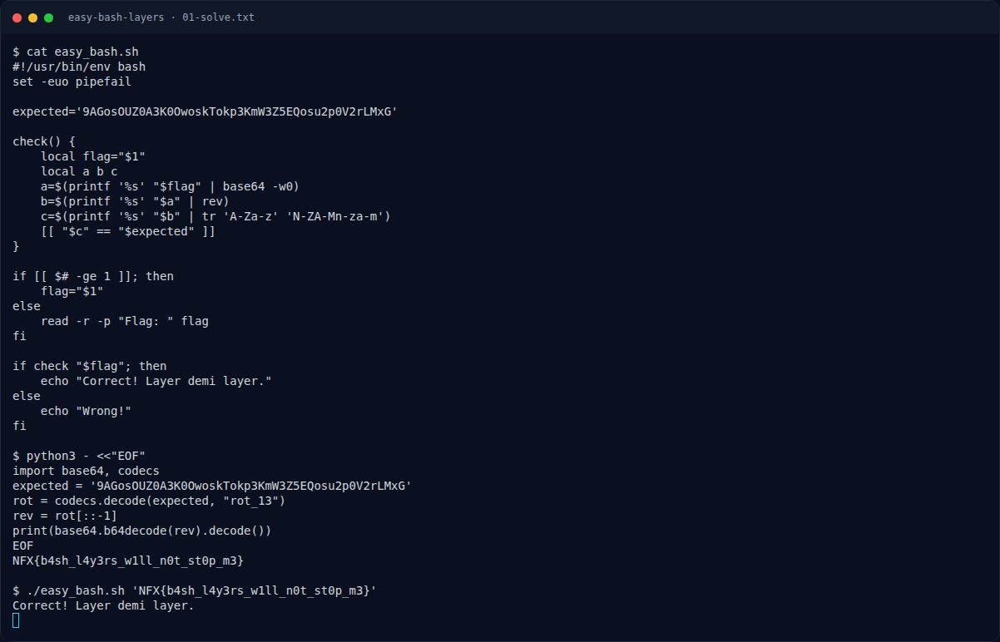

# Easy Bash Layers — Recon

[← Overview](59-easy-bash-layers.md) · [Index](index.md)

> **Langkah 1/6 — Recon.** Bagian pengecekannya:
>
> **Titik penting:** Bagian pengecekannya:
>
> **Berikutnya:** [Analisis](59-easy-bash-layers-02-analisis.md)

Buka script:

```bash
cat easy_bash.sh
```

Bagian pengecekannya:

```bash
a=$(printf '%s' "$flag" | base64 -w0)
b=$(printf '%s' "$a" | rev)
c=$(printf '%s' "$b" | tr 'A-Za-z' 'N-ZA-Mn-za-m')
[[ "$c" == "$expected" ]]
```

`expected`:

```text
9AGosOUZ0A3K0OwoskTokp3KmW3Z5EQosu2p0V2rLMxG
```

### Evidence langkah ini



*Terminal evidence — `01-solve.txt` (arsip transkrip sesi solve).*

**Berkas mentah langkah ini:**

- [`01-solve.txt`](assets/easy-bash-layers/01-solve.txt)
