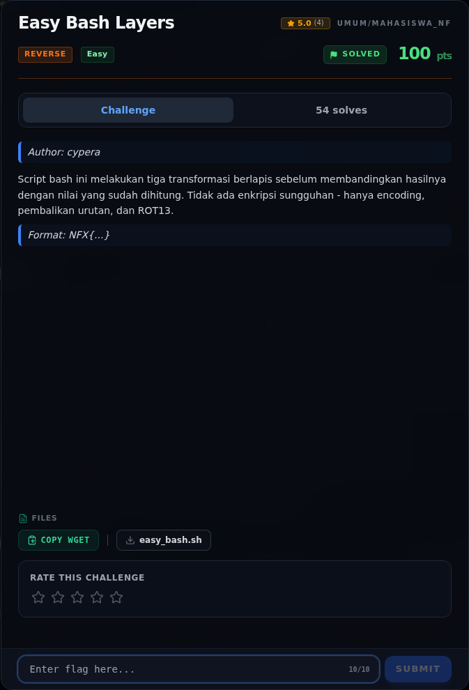

# Easy Bash Layers — Analisis

[← Overview](59-easy-bash-layers.md) · [Index](index.md)

> **Langkah 2/6 — Analisis.** Urutan encode: base64 → reverse → ROT13.
>
> **Titik penting:** Urutan encode: base64 → reverse → ROT13.
>
> **Berikutnya:** [Solver](59-easy-bash-layers-03-solver.md)

Urutan encode: `base64 → reverse → ROT13`.

Maka decode: `ROT13 → reverse → base64 decode`. ROT13 dua kali sama dengan tidak diapa-apakan, jadi kita bisa langsung pakai `codecs.decode(..., "rot_13")`.

### Evidence langkah ini

*Challenge brief asli di platform NFX CTF 2026.*
