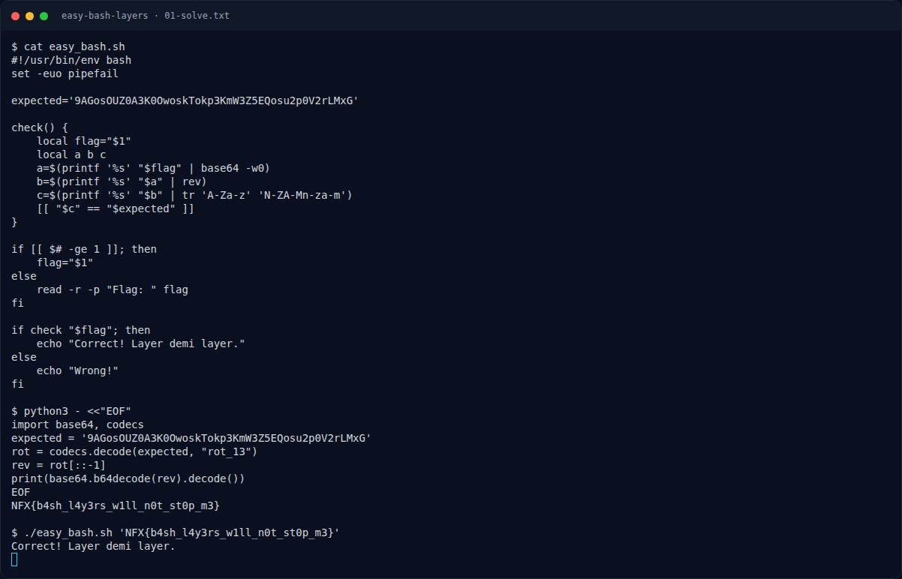

# Easy Bash Layers — Solver

[← Overview](59-easy-bash-layers.md) · [Index](index.md)

> **Langkah 3/6 — Solver.** Solver
>
> **Titik penting:** NFX{b4sh_l4y3rs_w1ll_n0t_st0p_m3} · Correct! Layer demi layer.
>
> **Berikutnya:** [Flag](59-easy-bash-layers-04-flag.md)

```python
import base64, codecs
expected = '9AGosOUZ0A3K0OwoskTokp3KmW3Z5EQosu2p0V2rLMxG'
rot = codecs.decode(expected, "rot_13")
rev = rot[::-1]
print(base64.b64decode(rev).decode())
```

Output:

```text
NFX{b4sh_l4y3rs_w1ll_n0t_st0p_m3}
```

Verifikasi:

```bash
./easy_bash.sh 'NFX{b4sh_l4y3rs_w1ll_n0t_st0p_m3}'
```

```text
Correct! Layer demi layer.
```

### Evidence langkah ini



*Terminal evidence — `01-solve.txt` (arsip transkrip sesi solve).*

**Berkas mentah langkah ini:**

- [`01-solve.txt`](assets/easy-bash-layers/01-solve.txt)
