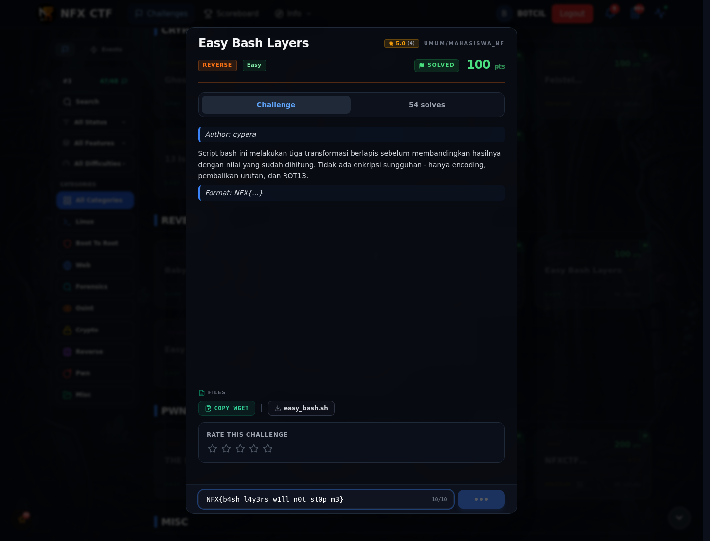

# Easy Bash Layers — Flag & Verifikasi

[← Overview](59-easy-bash-layers.md) · [Index](index.md)

> **Langkah 4/6 — Flag.** Flag
>
> **Titik penting:** NFX{b4sh_l4y3rs_w1ll_n0t_st0p_m3}
>
> **Berikutnya:** [Bukti / Evidence](59-easy-bash-layers-05-bukti-evidence.md)

> **Flag:** `NFX{b4sh_l4y3rs_w1ll_n0t_st0p_m3}`
> **Status:** `VERIFIED`

```text
NFX{b4sh_l4y3rs_w1ll_n0t_st0p_m3}
```

### Bukti submit di platform



*Submit flag di platform: `CORRECT, BUT ALREADY SOLVED.`*

> **Bukti submit:** screenshot form challenge di atas menampilkan `CORRECT, BUT ALREADY SOLVED.`
