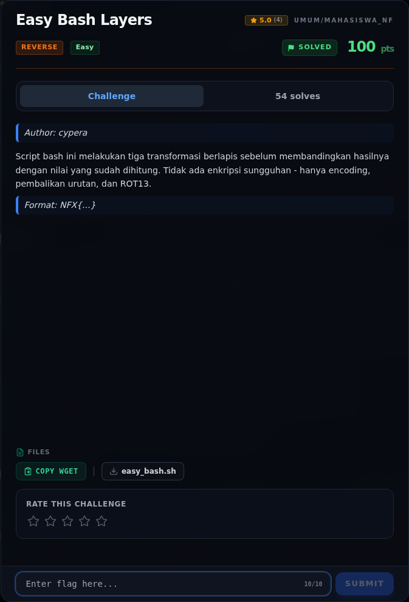

# Easy Bash Layers — Referensi

[← Overview](59-easy-bash-layers.md) · [Index](index.md)

> **Langkah 6/6 — Referensi.** Referensi
>
> **Titik penting:** —
>
> **Selesai.** Kembali ke [Overview](59-easy-bash-layers.md).

- Base64, `rev`, ROT13.
- Urutan encode harus dibalik saat decode.

### Evidence langkah ini

*Challenge brief asli di platform NFX CTF 2026.*
