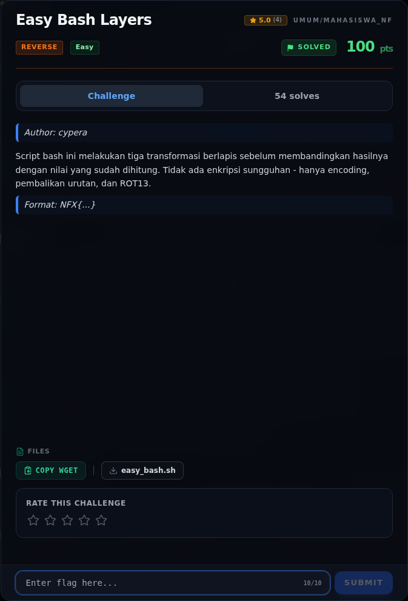
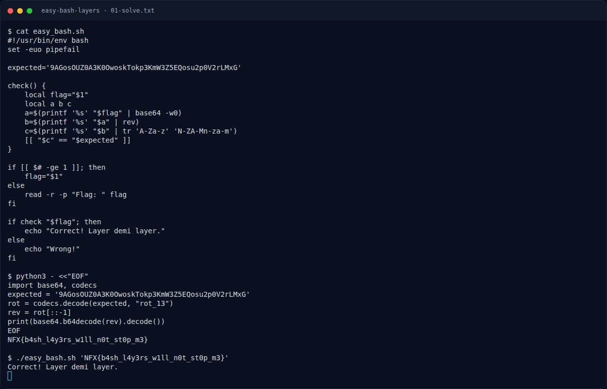

# Easy Bash Layers

Track Mahasiswa NF · ReverseEasy260 poinVERIFIED

| Field | Nilai |
|---|---|
| Event | `umum/mahasiswa_nf` |
| Kategori | `Reverse` |
| Difficulty | `Easy` |
| Poin (snapshot) | `260` |
| Author | `cypera` |
| Flag | `NFX{b4sh_l4y3rs_w1ll_n0t_st0p_m3}` |
| Status | `VERIFIED` |
| Snapshot | 2026-11-13 |

[← Kembali ke Index](index.md)

## TL;DR

- **Flag:** `NFX{b4sh_l4y3rs_w1ll_n0t_st0p_m3}`
- **Baca langkah lengkap:** [Cara Mendapatkan Flag](59-easy-bash-layers-04-flag.md)

## Challenge Brief (platform)

*Challenge brief asli di platform NFX CTF 2026.*

## Alur & Titik Penting

| # | Langkah | Titik penting | Buka |
|---:|---|---|---|
| 1 | Recon | Bagian pengecekannya: | [Buka](59-easy-bash-layers-01-recon.md) |
| 2 | Analisis | Urutan encode: base64 → reverse → ROT13. | [Buka](59-easy-bash-layers-02-analisis.md) |
| 3 | Solver | NFX{b4sh_l4y3rs_w1ll_n0t_st0p_m3} | [Buka](59-easy-bash-layers-03-solver.md) |
| 4 | Flag | NFX{b4sh_l4y3rs_w1ll_n0t_st0p_m3} | [Buka](59-easy-bash-layers-04-flag.md) |
| 5 | Bukti / Evidence | arsip screenshot dan transkrip | [Buka](59-easy-bash-layers-05-bukti-evidence.md) |
| 6 | Referensi | — | [Buka](59-easy-bash-layers-06-referensi.md) |

## Cerita singkat

Jadi ceritanya gini. Kita dikasih script Bash kecil. Dia mengecek flag dengan tiga lapis: base64, dibalik, lalu ROT13. Karena semua lapisannya reversibel, kita tinggal balik urutannya: ROT13 dulu, balik lagi, lalu decode base64.

Pratinjau evidence. Buka halaman <a href="59-easy-bash-layers-05-bukti-evidence.html">Evidence / Bukti</a> untuk semua screenshot dan transkrip.

## Navigasi Halaman

<a class="nx-page-card" href="59-easy-bash-layers-01-recon.html"><b>Recon</b>Enumerasi target dan bukti awal</a>
<a class="nx-page-card" href="59-easy-bash-layers-02-analisis.html"><b>Analisis</b>Membaca alur dan akar masalah</a>
<a class="nx-page-card" href="59-easy-bash-layers-03-solver.html"><b>Solver</b>Langkah exploit dan solver</a>
<a class="nx-page-card" href="59-easy-bash-layers-04-flag.html"><b>Flag</b>Flag dan verifikasi platform</a>
<a class="nx-page-card" href="59-easy-bash-layers-05-bukti-evidence.html"><b>Bukti / Evidence</b>Screenshot, transkrip, dan artefak</a>
<a class="nx-page-card" href="59-easy-bash-layers-06-referensi.html"><b>Referensi</b>Sumber dan bacaan lanjutan</a>

