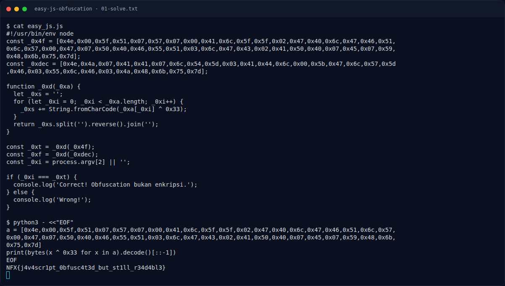

# Easy JS Obfuscation — Recon

[← Overview](60-easy-js-obfuscation.md) · [Index](index.md)

> **Langkah 1/6 — Recon.** Di dalamnya ada fungsi:
>
> **Titik penting:** Di dalamnya ada fungsi:
>
> **Berikutnya:** [Analisis](60-easy-js-obfuscation-02-analisis.md)

Buka file:

```bash
cat easy_js.js
```

Di dalamnya ada fungsi:

```javascript
function _0xd(_0xa) {
  let _0xs = '';
  for (let _0xi = 0; _0xi < _0xa.length; _0xi++) {
    _0xs += String.fromCharCode(_0xa[_0xi] ^ 0x33);
  }
  return _0xs.split('').reverse().join('');
}
```

Array `_0x4f` adalah kandidat flag, `_0xdec` adalah decoy.

### Evidence langkah ini



*Terminal evidence — `01-solve.txt` (arsip transkrip sesi solve).*

**Berkas mentah langkah ini:**

- [`01-solve.txt`](assets/easy-js-obfuscation/01-solve.txt)
