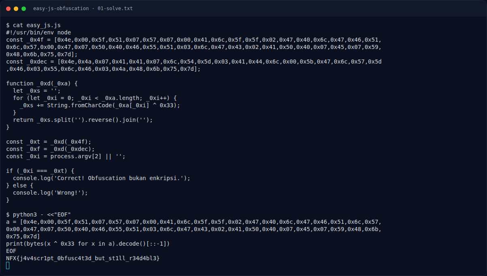

# Easy JS Obfuscation — Solver

[← Overview](60-easy-js-obfuscation.md) · [Index](index.md)

> **Langkah 3/6 — Solver.** Array decoy menghasilkan NFX{y0uf0undth3wr0ng4rr4y}.
>
> **Titik penting:** NFX{j4v4scr1pt_0bfusc4t3d_but_st1ll_r34d4bl3} · NFX{y0u_f0und_th3_wr0ng_4rr4y}
>
> **Berikutnya:** [Flag](60-easy-js-obfuscation-04-flag.md)

```python
a = [0x4e,0x00,0x5f,0x51,0x07,0x57,0x07,0x00,0x41,0x6c,0x5f,0x5f,0x02,0x47,0x40,0x6c,0x47,0x46,0x51,0x6c,0x57,0x00,0x47,0x07,0x50,0x40,0x46,0x55,0x51,0x03,0x6c,0x47,0x43,0x02,0x41,0x50,0x40,0x07,0x45,0x07,0x59,0x48,0x6b,0x75,0x7d]
print(bytes(x ^ 0x33 for x in a).decode()[::-1])
```

Output:

```text
NFX{j4v4scr1pt_0bfusc4t3d_but_st1ll_r34d4bl3}
```

Array decoy menghasilkan `NFX{y0u_f0und_th3_wr0ng_4rr4y}`.

### Evidence langkah ini



*Terminal evidence — `01-solve.txt` (arsip transkrip sesi solve).*

**Berkas mentah langkah ini:**

- [`01-solve.txt`](assets/easy-js-obfuscation/01-solve.txt)
