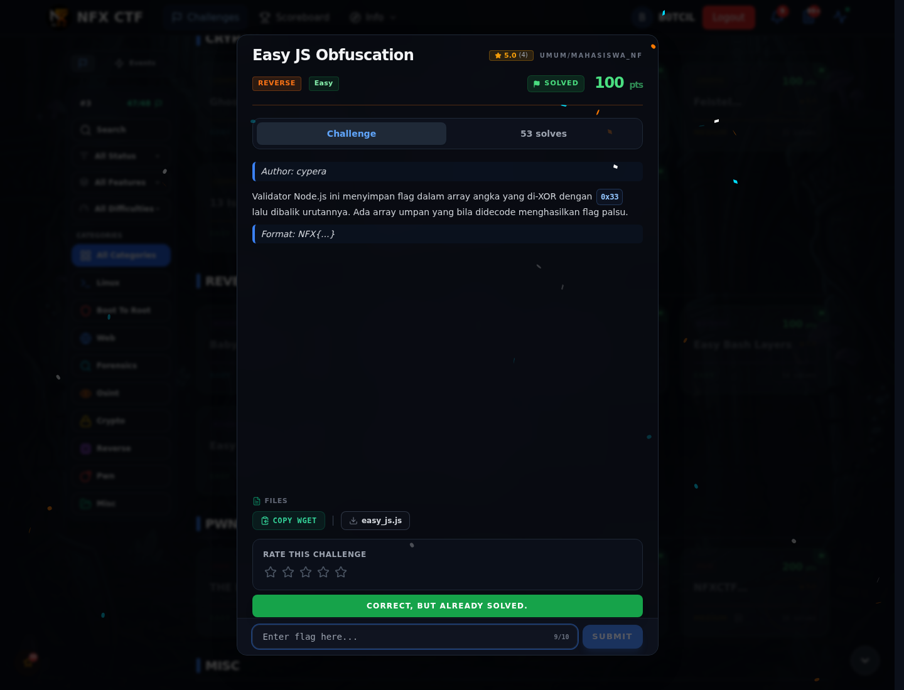

# Easy JS Obfuscation — Flag & Verifikasi

[← Overview](60-easy-js-obfuscation.md) · [Index](index.md)

> **Langkah 4/6 — Flag.** Flag
>
> **Titik penting:** NFX{j4v4scr1pt_0bfusc4t3d_but_st1ll_r34d4bl3}
>
> **Berikutnya:** [Bukti / Evidence](60-easy-js-obfuscation-05-bukti-evidence.md)

> **Flag:** `NFX{j4v4scr1pt_0bfusc4t3d_but_st1ll_r34d4bl3}`
> **Status:** `VERIFIED`

```text
NFX{j4v4scr1pt_0bfusc4t3d_but_st1ll_r34d4bl3}
```

### Bukti submit di platform



*Submit flag di platform: `CORRECT, BUT ALREADY SOLVED.`*

> **Bukti submit:** screenshot form challenge di atas menampilkan `CORRECT, BUT ALREADY SOLVED.`
