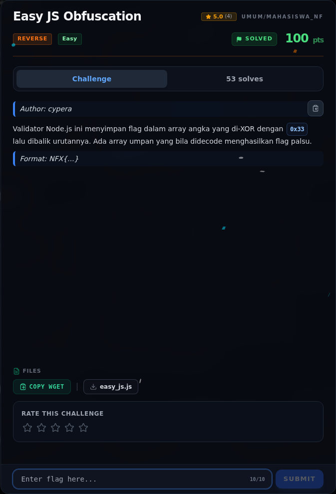

# Easy JS Obfuscation — Referensi

[← Overview](60-easy-js-obfuscation.md) · [Index](index.md)

> **Langkah 6/6 — Referensi.** Referensi
>
> **Titik penting:** —
>
> **Selesai.** Kembali ke [Overview](60-easy-js-obfuscation.md).

- XOR `0x33`, reverse string, array decoy.

### Evidence langkah ini

*Challenge brief asli di platform NFX CTF 2026.*
