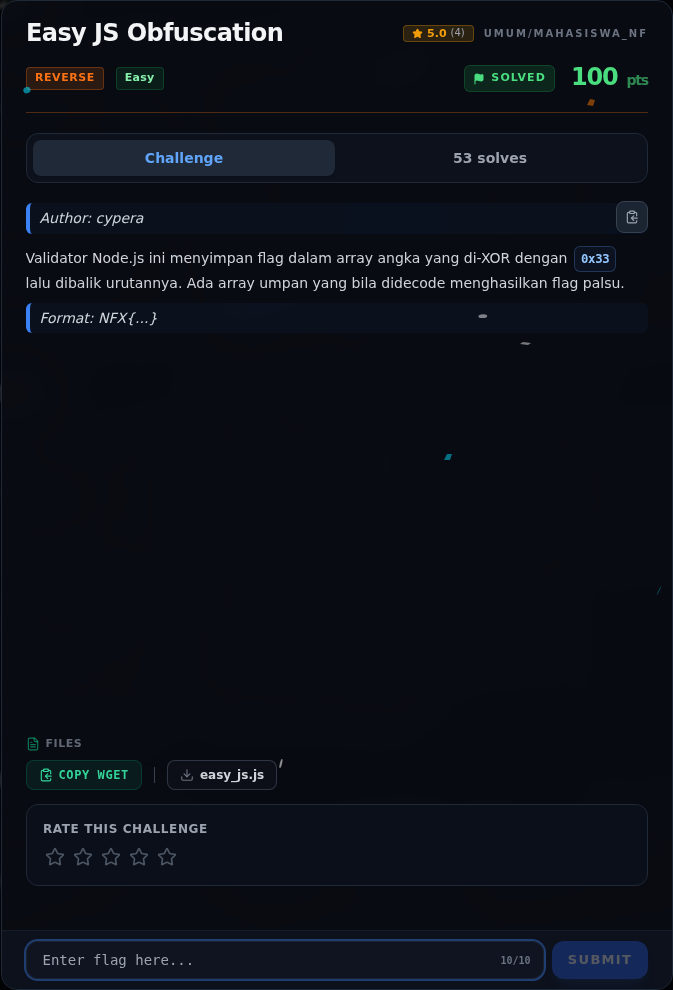
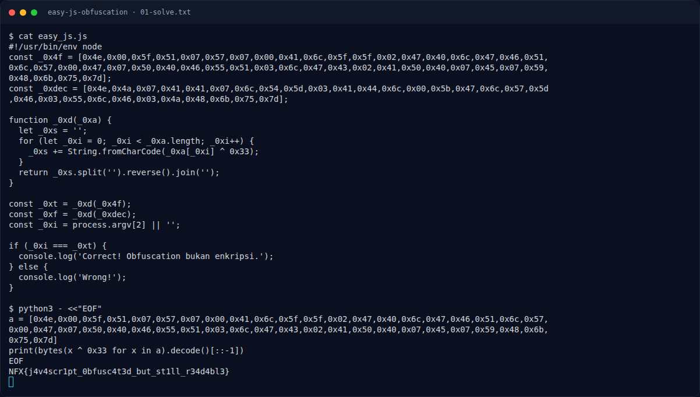

# Easy JS Obfuscation

Track Mahasiswa NF · ReverseEasy260 poinVERIFIED

| Field | Nilai |
|---|---|
| Event | `umum/mahasiswa_nf` |
| Kategori | `Reverse` |
| Difficulty | `Easy` |
| Poin | `260` |
| Author | `cypera` |
| Flag | `NFX{j4v4scr1pt_0bfusc4t3d_but_st1ll_r34d4bl3}` |
| Status | `VERIFIED` |
[← Kembali ke Index](index.md)

## TL;DR

- **Flag:** `NFX{j4v4scr1pt_0bfusc4t3d_but_st1ll_r34d4bl3}`
- **Baca langkah lengkap:** [Cara Mendapatkan Flag](60-easy-js-obfuscation-04-flag.md)

## Challenge Brief (platform)

*Challenge brief asli di platform NFX CTF 2026.*

## Alur & Titik Penting

| # | Langkah | Titik penting | Buka |
|---:|---|---|---|
| 1 | Recon | Di dalamnya ada fungsi: | [Buka](60-easy-js-obfuscation-01-recon.md) |
| 2 | Analisis | Prosesnya: XOR 0x33 per byte, lalu reverse. | [Buka](60-easy-js-obfuscation-02-analisis.md) |
| 3 | Solver | NFX{j4v4scr1pt_0bfusc4t3d_but_st1ll_r34d4bl3} | [Buka](60-easy-js-obfuscation-03-solver.md) |
| 4 | Flag | NFX{j4v4scr1pt_0bfusc4t3d_but_st1ll_r34d4bl3} | [Buka](60-easy-js-obfuscation-04-flag.md) |
| 5 | Bukti / Evidence | arsip screenshot dan transkrip | [Buka](60-easy-js-obfuscation-05-bukti-evidence.md) |
| 6 | Referensi | — | [Buka](60-easy-js-obfuscation-06-referensi.md) |

## Cerita singkat

Jadi ceritanya gini. Flag-nya disembunyiin di array angka JavaScript. Tiap angka di-XOR dengan `0x33`, lalu hasilnya dibalik. Ada dua array: satu flag asli, satu decoy. Kita tinggal decode array yang benar.

Pratinjau evidence. Buka halaman <a href="60-easy-js-obfuscation-05-bukti-evidence.html">Evidence / Bukti</a> untuk semua screenshot dan transkrip.

## Navigasi Halaman

<a class="nx-page-card" href="60-easy-js-obfuscation-01-recon.html"><b>Recon</b>Enumerasi target dan bukti awal</a>
<a class="nx-page-card" href="60-easy-js-obfuscation-02-analisis.html"><b>Analisis</b>Membaca alur dan akar masalah</a>
<a class="nx-page-card" href="60-easy-js-obfuscation-03-solver.html"><b>Solver</b>Langkah exploit dan solver</a>
<a class="nx-page-card" href="60-easy-js-obfuscation-04-flag.html"><b>Flag</b>Flag dan verifikasi platform</a>
<a class="nx-page-card" href="60-easy-js-obfuscation-05-bukti-evidence.html"><b>Bukti / Evidence</b>Screenshot, transkrip, dan artefak</a>
<a class="nx-page-card" href="60-easy-js-obfuscation-06-referensi.html"><b>Referensi</b>Sumber dan bacaan lanjutan</a>

