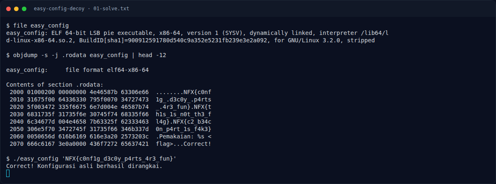

# Easy Config Decoy — Recon

[← Overview](61-easy-config-decoy.md) · [Index](index.md)

> **Langkah 1/6 — Recon.** Cek binary dan .rodata:
>
> **Titik penting:** file easy_config · objdump -s -j .rodata easy_config \| head -12 · NFX{th1s_1s_n0t_th3_fl4g}
>
> **Berikutnya:** [Analisis](61-easy-config-decoy-02-analisis.md)

Cek binary dan `.rodata`:

```bash
file easy_config
objdump -s -j .rodata easy_config | head -12
```

Di `.rodata` terlihat potongan:

```text
NFX{c0nf
1g_
d3c0y_
p4rts
_
4r3_fun}
```

Ada juga decoy:

```text
NFX{th1s_1s_n0t_th3_fl4g}
NFX{c2_b34c0n_p4rt_1s_f4k3}
```

### Evidence langkah ini



*Terminal evidence — `01-solve.txt` (arsip transkrip sesi solve).*

**Berkas mentah langkah ini:**

- [`01-solve.txt`](assets/easy-config-decoy/01-solve.txt)
